# The Primer — Product, Technical & Engineering Blueprint

> **Codename:** The Primer
> **Category:** AI-generated living storybook / lifelong learning companion for children
> **Inspiration:** Neal Stephenson's *The Diamond Age* ("A Young Lady's Illustrated Primer") + YC's *Request for Startups: The Primer*
> **Document type:** PRD + TDD + MVP Roadmap + Engineering Blueprint (single source of truth)
> **Audience:** Founders, engineers, designers, investors, YC partners, future employees
> **Status:** v1.0 — approved for implementation
> **Owner:** Solo founder (building with Claude)
> **Last updated:** 2026-08-07

---

## How to read this document

This is the single artifact a solo founder needs to begin building without further product discovery. It is deliberately exhaustive. It is organized so that a **product person** can read Sections 1–14, a **designer** Sections 3, 4, 12, 14, 15, and an **engineer** Sections 5, 16–21. Every non-obvious decision is followed by a short **Why** so the reasoning survives after the authors are gone.

Where the brief left a decision open, we resolved it explicitly (see *Locked Decisions* below) rather than hand-waving. Where we made an assumption, it is labeled **[ASSUMPTION]** and justified.

### Locked decisions (confirmed with the product owner)

| # | Decision | Choice | Rationale |
|---|----------|--------|-----------|
| D1 | Technical stack posture | **Opinionated & specific** | The team should start coding on day one, not run a stack bake-off. |
| D1a | Backend language/framework | **Python + Django (Django REST Framework)** | The founder's primary (and only) language is Python, not JavaScript; Django's batteries-included design (ORM, migrations, auth, admin) maximizes velocity for a solo builder. See Section 16. |
| D1b | Frontend | **React (Vite) SPA/PWA** talking to the Django API | Richest fit for the animated, streaming storybook UI. Node is used *only* as a build tool (Vite); there is no Node application/server code — all server logic is Python. |
| D2 | First client platform | **Web-first, responsive (tablet-optimized)** | Fastest path to a testable magical experience; no App Store review latency during the 15-day MVP; installable as a PWA to feel app-like on an iPad. Native wrappers come later (Section 25). |
| D3 | Team for the build | **Solo founder building with Claude as the development partner** (one person doing product, design, backend, frontend, and AI; Claude as pair-programmer, drafter, and reviewer) | This is the real constraint. The sprint plan (Section 21) is re-scoped for one person + AI, and calendar timelines are set honestly (Section 21.0), not as if a 4-person team were executing. |
| D4 | AI provider strategy | **Anthropic-primary, multi-provider fallback** | Claude for story/reasoning/safety; OpenAI + Google as failover; a dedicated image model (Flux / SDXL / Imagen) for illustration. A routing layer keeps us from vendor lock-in. |

### Global assumptions

- **[ASSUMPTION] Primary market at launch is English-speaking (US-first), with i18n as an architectural requirement but not an MVP deliverable.** Justification: COPPA is the strictest child-privacy regime we must satisfy anyway, US parents pay for kids' education apps, and English lets us reach a testable cohort fastest. The data model stores locale from day one so expansion is not a rewrite.
- **[ASSUMPTION] The paying customer is the parent; the child is the daily user.** All monetization, trust, and consent flows are parent-facing. Justification: children 3–7 cannot consent or pay, and COPPA requires verifiable parental consent.
- **[ASSUMPTION] Sessions are short (5–15 min) and often bedtime-adjacent.** Justification: attention spans at 3–7 and parents' routines. This shapes story-chunk length, latency budgets, and the "one adventure per sitting" model.
- **[ASSUMPTION] A "story session" costs money in model + image inference; we must keep unit economics visible from day one.** We budget and instrument cost-per-session (Section 22).
- **[ASSUMPTION] We are building a companion that persists for years, so data portability, memory durability, and account longevity are first-class concerns**, not afterthoughts.

---

## Table of Contents

1. [Executive Summary](#1-executive-summary)
2. [Product Philosophy](#2-product-philosophy)
3. [User Personas](#3-user-personas)
4. [User Journey](#4-user-journey)
5. [Product Architecture](#5-product-architecture)
6. [MVP Definition](#6-mvp-definition)
7. [Complete Feature List](#7-complete-feature-list)
8. [Story Engine](#8-story-engine)
9. [Companion System](#9-companion-system)
10. [Learning Engine](#10-learning-engine)
11. [Memory System](#11-memory-system)
12. [Parent Dashboard](#12-parent-dashboard)
13. [Safety](#13-safety)
14. [UX Design](#14-ux-design)
15. [Design System](#15-design-system)
16. [Technical Architecture](#16-technical-architecture)
17. [Database Schema](#17-database-schema)
18. [API Design](#18-api-design)
19. [AI System Design](#19-ai-system-design)
20. [Engineering Roadmap](#20-engineering-roadmap)
21. [MVP Sprint Plan (15 days)](#21-mvp-sprint-plan-15-days)
22. [Metrics](#22-metrics)
23. [Risks](#23-risks)
24. [Competitive Analysis](#24-competitive-analysis)
25. [Future Vision](#25-future-vision)

---

## 1. Executive Summary

### Mission
Give every child a companion that makes learning feel like living inside an adventure — one that remembers who they are and grows with them for a decade.

### Vision
The Primer is **the world's first AI-generated living storybook that grows alongside every child**. It is not an AI tutor and it is not a chatbot. It is a story world with a single recurring companion, where education happens *underneath* the narrative and is never visible as "school." Over years, the child builds a real emotional relationship with a companion that remembers their favorite characters, their fears, their strengths, their weaknesses, and every adventure they have shared.

### Core insight
The internet already has infinite educational content. **The scarce resource is not content — it is personalization at the level of a story that a specific child wants to live inside.** Existing apps deliver near-identical lesson → quiz → reward loops to millions of children. Attention collapses because nothing is *theirs*. Generative AI, for the first time in history, makes it economically feasible to author a unique, coherent, emotionally-continuous narrative world for every individual child, and to keep that world consistent across years. The Primer is the productization of that shift.

### Opportunity
- The global pre-K / early-childhood digital learning market is large and durable; parents spend willingly on their children's development and reliably renew subscriptions that "work."
- Incumbents (ABCmouse, Khan Academy Kids, Lingokids, Duolingo, Osmo, Pok Pok) either sell static content libraries or gamified drills. None deliver a persistent, personalized narrative companion.
- The defensible asset is not the model — it is the **accumulated per-child memory graph** and the trust of the parent. Both compound. A four-year-old's companion at fourteen is not replaceable by a competitor's cold-start product.

### Market timing / Why now
1. **Frontier LLMs are finally good enough** at long-form coherent narrative, instruction-following, and structured output to sustain a consistent story world with characters that persist.
2. **Inference cost has fallen** to the point where a personalized 5–10 minute illustrated story per child per day is affordable at consumer price points, and continues to fall.
3. **Image generation** is now fast, cheap, and controllable enough (style consistency, character consistency via reference/LoRA) to illustrate those stories.
4. **Parents' trust bar for AI + kids is high and rising** — which is a moat for whoever earns it first with visibly safe, transparent design. Being early *and* trustworthy is the wedge.
5. **Retrieval + long-context memory** are now robust enough to make "the companion remembers everything" a real feature rather than a demo.

### North Star
**Weekly Returning Children who complete ≥3 adventures per week ("Delighted Weekly Actives").** This single metric captures the whole thesis: a child came back, *multiple times*, and *finished* the experience — meaning it was emotionally engaging, age-appropriate in length, and worth the parent's trust. Learning outcomes and revenue both follow from it. (Full metric tree in Section 22.)

### Long-term ambition
Become the **operating system for childhood learning** — the default place a generation of children go to learn, imagine, and be accompanied. In ten years the companion is multi-modal (voice, ambient device, AR), available in dozens of languages, trusted by schools and therapists, and open to third-party story and skill developers. The moat is a decade of memories per child and the deepest child-safety and child-learning research practice in the industry.

---

## 2. Product Philosophy

This section is the "why" that every downstream design and engineering decision must serve. If a feature violates a principle here, the principle wins.

### 2.1 Why stories work

Narrative is the oldest and most powerful learning technology humans have. Three mechanisms matter for us:

**Stories encode information in causal, memorable structure.** Humans remember narratively-structured information far better than lists of facts because stories carry *causality* ("she was cold, **so** she built a fire") and *emotion*, both of which are strong retrieval cues. A number in a drill is inert; the same number inside "we need exactly five stones to cross the river" is load-bearing and sticky.

**Stories create transportation.** When a child is "transported" into a narrative, attention becomes effortless and self-sustaining — the opposite of the extrinsic-reward treadmill that most kids' apps rely on. Transported learners are not resisting the lesson; there is no felt lesson to resist.

**Stories let a child rehearse being someone.** Identification with a character lets a child safely practice courage, patience, empathy, and problem-solving. This is *social and emotional learning* delivered as felt experience rather than instruction.

### 2.2 How children aged 3–7 actually learn

The design must respect the developmental reality of the age band, which spans an enormous cognitive range (a 3-year-old and a 7-year-old are almost different species). Key facts we design around:

- **Learning is embodied, playful, and social before it is abstract.** Children this age learn through play, repetition, story, song, and interaction with a trusted other — not through explanation. Our companion *is* that trusted other.
- **Working memory is small and fragile.** Instructions must be one step at a time. Choices must be few (2–3, never a wall of options). Cognitive load is the enemy.
- **Attention is short and interest-gated.** A child will attend for a surprisingly long time to something they chose and love, and for seconds to something imposed. Personalization is therefore not a nicety — it is the mechanism that buys attention.
- **The zone of proximal development is real and narrow.** Content that is slightly beyond current ability, scaffolded by a supportive companion, produces growth; too hard produces shutdown, too easy produces boredom. The engine must continuously estimate and track each child's edge (Section 10).
- **Repetition is a feature, not a bug.** Young children *want* to re-experience the familiar; mastery comes from repetition with small variation. Our story engine reuses beloved characters and motifs while varying the challenge.
- **Emotional safety gates everything.** A frightened or shamed child does not learn. There are no wrong answers that produce failure states; there are only different paths and gentle re-tries.

### 2.3 Cognitive science we exploit deliberately

- **Spaced retrieval:** skills and vocabulary are re-surfaced across future stories at increasing intervals, disguised as plot ("Remember the word *brave*? Today Pip must *be* brave.").
- **Interleaving:** counting, phonics, and social reasoning are woven together within and across adventures rather than blocked, which improves durable learning.
- **Desirable difficulty:** the engine aims the challenge just above current mastery so effort is real but success is reachable.
- **Elaboration & self-explanation:** the companion occasionally asks the child *why* ("Why do you think the bridge fell?"), prompting the child to construct understanding rather than receive it.
- **Dual coding:** every concept arrives as words *and* image *and* (later) voice, giving multiple memory traces.

### 2.4 Why personalization matters (the central bet)

Generic content produces generic attention. A child who loves dinosaurs and fears the dark will attend completely to a story about a small brave dinosaur who learns the dark is safe — and not at all to a stock lesson about the number four. **Same learning objective, radically different engagement, because one is theirs.** Personalization is how we convert the infinite-content world into felt relevance. It is also our moat: the personalization compounds because it is built on accumulated memory (Section 11).

### 2.5 Why emotional attachment matters

A companion the child *loves* is one they return to voluntarily, trust enough to be challenged by, and remember for years. Attachment is what turns a content app (churned in weeks) into a childhood relationship (retained for years). We build attachment deliberately and ethically:

- **Continuity:** the same companion, remembering shared history, across every session.
- **Reciprocity:** the companion remembers what the child told it and refers back to it ("You told me you have a dog named Biscuit — the puppy in today's story reminds me of Biscuit.").
- **Growth together:** the companion visibly grows/changes as the child does (Section 9).
- **Reliability & warmth:** never punitive, never cold, always glad to see the child.

**Ethical guardrail (non-negotiable):** attachment is designed to *support the child's real-world relationships and development, never to substitute for them or to maximize screen time.* We include friction against overuse (Section 13.6), we encourage co-play with parents, and we explicitly design the companion to point outward ("Go show your mom the dragon you named!"). A product that exploited a child's attachment to maximize engagement would be both unethical and, given parent scrutiny, commercially fatal. This is stated here as a first principle because every engagement decision must pass it.

### 2.6 Design principles (the constitution)

These are absolute. Every screen, prompt, and feature is checked against them.

1. **Never feel like school.** No lessons, grades, quizzes-as-quizzes, or homework framing — ever. Learning objectives exist only in the backend.
2. **The story is the interface.** Navigation, choices, and progress are all expressed through narrative, not menus and dashboards (those are for parents).
3. **Never overwhelm.** One thing on screen at a time. 2–3 choices maximum. Large targets. Generous whitespace. Calm pacing.
4. **No AI-assistant UI.** No chat bubbles, no blinking cursor, no "type your prompt." The child speaks or taps; the world responds.
5. **Minimal text for the child.** The child cannot necessarily read. Voice/audio and image carry the experience; text is optional reinforcement.
6. **Magical, not mechanical.** Transitions, reveals, and the companion's reactions should feel alive. Latency is hidden inside narrative beats.
7. **Parents trust it; children love it.** Two audiences, two surfaces (Section 3). Trust for parents is earned through transparency and control; love for children is earned through personalization and warmth.
8. **Safe by construction, not by patch.** Safety is an architectural layer every generation passes through (Section 13), not a content filter bolted on later.

---

## 3. User Personas

We design for four personas. Only the first two matter for the MVP; the latter two shape architecture so we don't paint ourselves into a corner.

### 3.1 Primary customer — "Priya," the parent (the buyer & the trust-gate)

**Profile:** 30–42, has a 3–7 year old, moderately tech-comfortable, time-poor, cares deeply about the child's development and about screen-time quality. Has been burned by "educational" apps that were actually ad-riddled game loops.

**Goals:**
- Give the child something *good* to do with screen time — enriching, calm, not junk.
- See evidence the child is learning and growing, without having to become a teacher.
- Trust that the content is safe, age-appropriate, private, and non-manipulative.
- Keep setup and daily friction near zero (she does not have time for a "parent homework" app).

**Pain points:**
- "Educational" apps that are really slot machines for attention.
- No visibility into whether anything is actually being learned.
- Anxiety about AI + kids: data, safety, "what is it saying to my child?"
- Guilt about screen time; wants screen time she can feel good about.

**Daily workflow:** Hands the tablet over at a predictable moment (post-dinner / pre-bed / weekend morning). Ideally sometimes co-watches. Checks a short parent summary a few times a week, not daily. Renews the subscription because she can *see and feel* it working.

**What earns Priya:** transparency (she can read exactly what her child experienced), control (limits, topics to include/avoid, off-switches), visible learning ("your child mastered counting to ten this week, and here's the story where it happened"), and a product that never feels manipulative.

### 3.2 Secondary user — "Aarav," the child (the daily user, the one who must fall in love)

**Profile:** 3–7. May not read yet. Operates by tapping and (later) talking. Emotionally the center of the product. Wildly individual: loves specific things (trucks, cats, space, princesses, dinosaurs), fears specific things (the dark, loud noises, being alone), has a specific temperament.

**Goals (as the child experiences them — never framed as learning):**
- See what my friend (the companion) and I do today.
- Be in the adventure. Make the choices. Be the hero.
- Revisit the characters and places I love.

**Pain points (as friction the child feels):**
- Boredom (content not theirs) → immediate disengagement.
- Confusion (too many options, too much text, unclear what to do) → frustration.
- Fear (content too intense) → shutdown and loss of trust.
- Waiting (latency) → attention gone.

**Daily workflow:** Opens the app (or a parent opens it), is greeted *by name* by the companion who remembers yesterday, chooses/enters today's short adventure, makes a few choices, reaches a satisfying ending, is gently told it's time to go. Wants to come back tomorrow.

### 3.3 Future persona — "Ms. Okafor," the teacher / homeschool parent

**Profile:** Early-childhood educator or homeschooling parent managing multiple children. Wants curriculum alignment, class/roster management, and per-child insight without per-child labor.

**Goals:** assign or theme adventures to reinforce classroom topics; see each child's progress against developmental milestones; trust it's safe for a classroom. **Pain points:** most kid apps don't scale to a roster or map to standards. **Shapes architecture:** multi-child accounts, cohort roles, milestone framework mapped to common early-learning standards. (Post-MVP, Section 25.)

### 3.4 Future persona — "Dr. Lin," the therapist / special-education specialist

**Profile:** Speech-language pathologist, child psychologist, or SPED teacher. Would use personalization + memory to support kids with specific needs (autism spectrum, speech delay, anxiety, dyslexia-risk).

**Goals:** tailor pacing, sensory intensity, and content to a child's profile; track narrow, clinically-relevant skills; export progress. **Pain points:** generic apps are not adaptable to atypical development. **Shapes architecture:** the difficulty/sensory/pacing parameters must be exposable and overridable; the memory and skill models must be granular. (Post-MVP; also a strong trust/PR asset — building for the margins improves the core.)

### 3.5 Persona → design implication matrix

| Persona | Their surface | Primary need | Non-negotiable we owe them |
|---------|---------------|--------------|----------------------------|
| Parent (Priya) | Parent Dashboard (text-rich, informative) | Trust + visible value | Transparency, control, privacy, real insight |
| Child (Aarav) | The Story (image/voice-first, minimal text) | To be delighted and seen | Personalization, warmth, safety, zero confusion, low latency |
| Teacher (future) | Educator console | Scale across a roster | Milestone mapping, multi-child management |
| Therapist (future) | Clinical controls | Fine-grained tailoring | Granular parameters + skill tracking, export |

---

## 4. User Journey

Every interaction below is designed against the Section 2 constitution. Latency, safety, and "never feels like school" are load-bearing throughout.

### 4.1 First launch (parent present) — the trust moment

The very first screen is for the *parent*, not the child, and its job is to earn trust in under 60 seconds. It states plainly, in warm human language: what The Primer is (a story companion that teaches through adventures), what it will and won't do, that it's private and safe, and that the parent is in control. No dark patterns, no forced account before value is shown.

**Why:** the parent's trust is the gate to everything. We spend the first impression on trust, not on a splashy child demo, because a parent who doesn't trust us never lets the child in.

### 4.2 Onboarding & parent setup (2–4 minutes, parent-driven)

A short, warm, mostly-optional flow:
1. **Create account** (email + password, or OAuth). Verifiable parental consent step begins here (Section 13.7).
2. **Add a child:** first name (or nickname the companion will use), age/birthdate, and — framed delightfully — "What does [name] love? What are they a little scared of? What should we make sure to include or avoid?" These become the seeds of personalization and safety.
3. **Choose or co-create the companion:** pick from a few archetypes (a small dragon, a curious robot, a gentle fox, a star) or let the child help name/color it. (See Section 9 for companion genesis.)
4. **Set boundaries:** session length cap, topics to avoid, quiet/scary intensity ceiling, daily time window.
5. **Handoff cue:** "Ready? Hand [name] the tablet and meet [companion]." 

**Why this order:** consent and safety first, then the two inputs that drive the entire engine (the child's loves/fears and the companion identity). Everything optional is skippable so a tired parent can finish in a minute and the child still gets a great first story from defaults + age.

### 4.3 Child introduction — meeting the companion (the "imprint")

The child's first moment is not a menu. It is the companion *arriving* — an animated, voiced, warm hello **that uses the child's name**: "Hi Aarav! I'm Pip. I've been waiting to meet you. Want to go somewhere today?" The companion is curious about the child (asks one or two gentle, playful questions whose answers seed memory), then opens the first adventure.

**Why:** first impressions form attachment. We spend it on *being seen* ("it knows my name and wants to know me"), which is the emotional core of the whole product.

### 4.4 First story (5–8 minutes) — proof of magic

A short, complete, illustrated, voiced adventure built from the seeds (loves/fears/age). It has: a hook, a gentle challenge that quietly embeds one learning objective at the child's level (e.g., counting to three, or naming a feeling), 2–3 meaningful choices, a small triumph, and a warm ending that plants a hook for tomorrow ("Pip yawns. 'That was the best. Come back tomorrow — I found a map to somewhere new.'").

**Success criterion:** the child *finishes* it and, ideally, immediately wants another. Completion of the first story is our activation event (Section 22).

### 4.5 Second day — the memory payoff

The companion greets the child by name and **references yesterday** ("Aarav! Yesterday you were so brave with the shadow. Today the map leads to the Whispering Woods…"). Today's story reuses a loved element and nudges the challenge slightly. 

**Why day two is the whole business:** returning and being *remembered* is the moment the product stops being an app and starts being a relationship. Our entire retention thesis lives here.

### 4.6 One week

The child has 4–6 adventures of shared history. Recurring characters and a "home base" location have emerged. The companion has learned more (favorite color surfaced, a fear being gently worked through, a skill edge identified). The **parent gets the first weekly summary**: what the child experienced, what they're learning, a milestone or two, and a warm, specific highlight ("Aarav named the dragon 'Sparkle' and decided to help it instead of run — a lovely bit of empathy."). This is when the parent decides the product is real.

### 4.7 One month

A **world** now exists — a map of places visited, a cast of remembered characters, an inventory of meaningful objects the child chose or earned, and a visible growth arc. The companion has subtly evolved (Section 9). Learning has interleaved counting, early phonics/vocabulary, and social-emotional skills across many stories. The parent sees a monthly growth view and trusts the trajectory. This is the natural first renewal point.

### 4.8 One year

The companion is a fixture of the child's life. It remembers dozens of adventures, the child's evolved interests (dinosaurs gave way to space), fears overcome, and a rich skill profile. Difficulty has scaled with the child. The relationship is real and the switching cost — emotional and informational — is enormous: no competitor can offer a companion that has known this child for a year. **This is the moat, experienced.**

### 4.9 Interaction-level detail (the anatomy of one story beat)

Within any single story, one "beat" works like this, and this pattern repeats:

1. **Scene renders** — illustration + short narration (voiced; text optional). ~15–30 seconds of content.
2. **A gentle prompt or choice** — the companion poses one thing: a 2–3 option choice, or a simple interaction (tap the three apples, say the animal's name, pick a path).
3. **Child acts** — tap or (later) voice.
4. **Consequence** — the world and companion respond warmly and specifically; the choice *mattered* and is remembered.
5. **Micro-encouragement** — never grades; celebrates effort and character ("You *thought* about that. I like how you help.").
6. **Transition** — a narrative beat masks any generation latency ("Pip leads you down the mossy path…" while the next scene renders).

**Latency-hiding is a core UX mechanic:** we never show a spinner to a child. Loading is always dressed as narration, animation, or the companion "thinking out loud." (Engineering consequence: prefetch and stream — Sections 16, 19.)

---

## 5. Product Architecture

This section is the conceptual system map (components, responsibilities, data flow, and the pipelines the brief enumerated). The concrete stack, deployment, and scaling live in Section 16; here we establish *what the parts are and how a request flows.*

### 5.1 High-level architecture

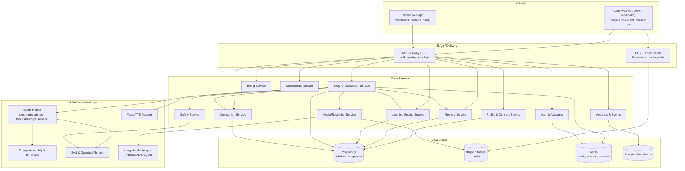

> **Note on "services":** at MVP — a solo founder building with Claude — these are **logical modules inside a single deployable (a modular monolith)**, not separate microservices. We draw them as services because the *boundaries* are real and we will split them out under load (Section 16.9). Designing the seams now costs nothing and saves a painful re-architecture later.

### 5.2 Component responsibilities

| Component | Responsibility | Key collaborators |
|-----------|----------------|-------------------|
| **Auth & Accounts** | Parent identity, sessions, OAuth, child-profile ownership | Gateway, Profile |
| **Profile & Consent** | Child profiles, preferences, loves/fears, boundaries, COPPA consent records | Auth, Story, Safety |
| **Story Orchestration** | The conductor: assembles context, calls AI layer, sequences beats, streams to client, persists the adventure | Memory, Learning, Companion, Safety, Media, AI layer |
| **Companion Service** | Companion identity, personality, evolution state, voice | Story, Memory |
| **Learning Engine** | Skill model per child, objective selection, difficulty, mastery tracking, spaced retrieval scheduling | Story, Memory, Analytics |
| **Memory Service** | Short- and long-term memory, embeddings/retrieval, interest & growth graphs | Story, Learning, Companion |
| **Safety Service** | Input/prompt-injection defense, output moderation, age-appropriateness, escalation | Story, AI layer, Notifications |
| **Media/Illustration** | Style-consistent illustration generation, character consistency, caching | Story, Object Storage, CDN |
| **AI Orchestration** | Model routing, prompt assembly, structured output, evals, fallback, image/TTS adapters | Story, Safety |
| **Analytics & Events** | Event capture, metrics, learning-outcome computation, dashboards feed | All services → Warehouse |
| **Billing** | Subscriptions, trials, entitlements | Auth, Parent app |
| **Notifications** | Parent summaries, re-engagement (parent-only), safety escalations | Analytics, Safety |

### 5.3 Story generation pipeline (the heart)

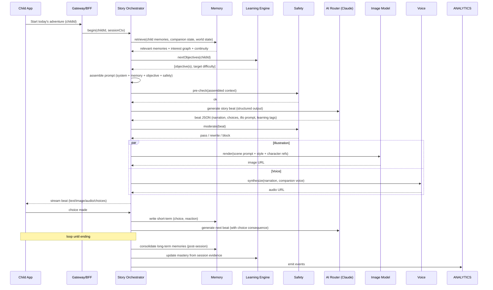

### 5.4 Memory pipeline

Two-tier, mirroring human memory (full detail in Section 11):

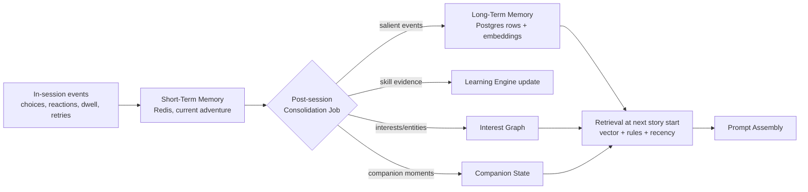

**Why two tiers + a consolidation job:** we cannot stuff a decade of history into a prompt, and we shouldn't want to. Consolidation lets us *decide what matters* (salience scoring), keep prompts small and cheap, and make retrieval about the *right* memories, not all of them. It also mirrors how memory should feel to the child — the companion remembers the *important* things, like a friend does.

### 5.5 Learning pipeline

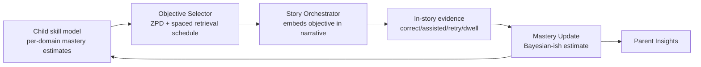

The learning loop is closed and invisible: the model picks what to teach next, the story teaches it without naming it, the child's behavior is evidence, the estimate updates, and the parent sees the *result* (not the machinery). Detail in Section 10.

### 5.6 Analytics pipeline

Events flow from every service to a warehouse. Two consumers: (1) **product/ops** (activation, retention, engagement, cost-per-session, safety incidents) and (2) **parent-facing insight** (a heavily curated, child-appropriate subset — completion, milestones, skills touched). We keep these strictly separated so raw behavioral data never leaks into the parent view unfiltered, and child data is minimized and access-controlled (Section 13).

### 5.7 Safety pipeline

Safety is not a stage — it wraps the whole generation. Detail in Section 13; architecturally:

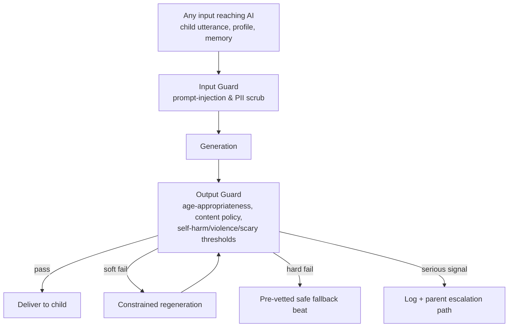

### 5.8 Illustration pipeline

```mermaid
flowchart LR
    A[Beat scene description<br/>from Story Orchestrator] --> B[Illustration Prompt Builder<br/>+ global style tokens<br/>+ character reference set]
    B --> C[Image Model<br/>Flux/SDXL/Imagen]
    C --> D[Safety scan of image]
    D --> E[Store to Object Storage + CDN]
    E --> F[Cache by (styleHash, characterHash, sceneHash)]
    F --> G[Deliver / reuse]
```

**Character & style consistency is the hard part.** A child will not accept a companion that looks different every scene. We hold consistency via: a fixed global **style token set** (art direction), and a per-character **reference set / seed / LoRA-or-embedding** so "Pip the dragon" is recognizably Pip in every image (Section 8.2, 16.6). We aggressively cache: identical (style, character, scene) tuples are reused, and companion/character "portrait" assets are generated once and reused as references. This is both a quality lever and a major cost lever (Section 22).

### 5.9 Request flow summary (who owns what latency)

- **Perceived-instant (<100ms):** taps, choice acknowledgment, UI motion — pure client.
- **Fast (<1s):** cached illustrations, next-beat prefetch hits, companion voice from cache.
- **Story-paced (1–5s, hidden by narration):** live LLM beat generation, fresh illustration, TTS.
- **Async (post-session):** memory consolidation, mastery update, analytics, parent-summary generation.

The golden rule from Section 4.9 governs the whole system: **the child never waits at a spinner; latency is always inside a narrative beat.** This is why the Story Orchestrator prefetches the next beat and its media while the child is still engaged with the current one.

---

## 6. MVP Definition

**The MVP question is: what is the smallest thing that proves the core magic — a personalized, illustrated, voiced adventure with a companion that remembers — that one founder, building with Claude, can ship to a real parent and child?**

We are brutally realistic. A solo builder cannot build the operating system for childhood in one sprint. We can build **one loop, done well**: a parent onboards, a child meets a companion, plays a genuinely personalized illustrated story, comes back the next day, and is *remembered*. If that loop produces delight and a "day-two return," the thesis is validated. Everything else waits.

### 6.1 The one sentence MVP

> A parent signs up, creates a child profile and companion in ~3 minutes, and the child plays a short, personalized, illustrated, voiced branching adventure; the next day the companion greets them by name and references what happened yesterday; the parent can read a simple summary of what their child experienced and learned.

### 6.2 MoSCoW

#### Must Have (without these, the thesis isn't tested)

| Feature | Why it's a Must |
|---------|-----------------|
| Parent auth + account (email/OAuth) | Gate for consent, billing later, and data ownership. |
| Verifiable-parental-consent-lite + clear privacy disclosure | Legal floor for a kids' product; also the trust moment. |
| Child profile (name, age, 2–3 loves, 1–2 fears/avoids) | The seeds of personalization; without them it's generic. |
| Companion creation (pick archetype + name/color) | The relationship anchor; the thing the child bonds to. |
| **Story engine: generate a short branching illustrated adventure** at the child's age/level from profile + memory | This *is* the product. |
| Streaming beat delivery with **latency hidden in narration** | Non-negotiable UX; a spinner breaks the spell. |
| Illustration generation with **style + companion consistency** | A story the child can *see*; consistency is what makes it feel real. |
| Text-to-speech narration (companion voice) | The child may not read; voice carries the experience. |
| 2–3 choices per decision point with real consequences | Agency = engagement; "I did that." |
| **Memory: persist adventures + salient facts; day-two greeting references yesterday** | The differentiator; the reason it's a companion, not an app. |
| Learning objective embedded invisibly (counting OR early vocabulary to start) | Proves education-under-story without feeling like school. |
| Safety layer: input guard + output moderation + safe fallback | Ships on day one, not later. Table stakes for kids + AI. |
| Parent summary (per-session + simple weekly) | The parent's proof-of-value; drives retention/renewal. |
| Session length cap + "time to go" ending | Trust + child wellbeing; parents demand it. |
| Basic analytics/events (activation, completion, return) | We must measure whether the loop works. |

#### Should Have (strongly desired in the 15 days if time allows; otherwise week 3–4)

- Voice *input* from the child (say an answer/name). *Deferred from Must because ASR for young children is hard and error-prone; tap-first is safer for MVP.*
- Recurring characters + a simple persistent "world map" of places visited.
- Companion small evolution (visual/mood change over sessions).
- Multiple learning domains interleaved (add early phonics + one social-emotional skill).
- Parent controls: topic avoid-list, intensity ceiling, daily time window.
- Free trial + subscription paywall (Stripe).

#### Could Have (nice, not now)

- Multiple children per account with switching.
- Achievements / collectible objects surfaced to the child as narrative treasures.
- Weekly email digest to the parent.
- Offline/download a finished story to re-read.
- Themed "story packs" (space week, ocean week).

#### Won't Have (explicitly out of MVP — stated so no one builds them)

- Native iOS/Android apps (web-first PWA per D2).
- Teacher/therapist consoles and rostering (Section 3.3/3.4 are architecture-only for now).
- AR/VR/voice-device/robotics (Section 25 futures).
- Third-party developer platform / marketplace.
- Multi-language localization (architected for, not built).
- Real-time parent-child co-play multiplayer.
- Anything resembling open-ended chat with the child.

**Why this cut:** the Must-Haves are exactly the loop in 6.1 and nothing else. Every Must maps to a claim in the thesis (personalized, illustrated, voiced, remembered, safe, learning-bearing, parent-trusted). We ruthlessly removed anything that adds surface area without testing the thesis. Voice input, the most tempting cut-line item, is a *Should* precisely because child ASR failure would damage the magic more than tapping does.

---

## 7. Complete Feature List

Organized by domain. **[M]** = MVP Must, **[S]** = Should, **[C]** = Could, **[F]** = Future. This is the full surface area of the product across its life, not just the MVP.

### 7.1 Authentication & Accounts
Parent email/password + OAuth (Google/Apple) **[M]**; email verification **[M]**; password reset **[M]**; verifiable parental consent record **[M]**; session management/refresh tokens **[M]**; multi-device login **[S]**; account deletion + data export (GDPR/CCPA) **[M]**; multi-caregiver access to one family **[C]**; SSO for schools **[F]**.

### 7.2 Parent Dashboard
Per-session summary **[M]**; weekly summary **[M]**; learning insights (skills touched, mastery movement) **[S]**; growth over time view **[S]**; milestone timeline **[C]**; recommendations ("try a counting week") **[C]**; transparency log (read exactly what the child experienced) **[M]**; export report (PDF) **[C]**; monthly email digest **[C]**.

### 7.3 Child Profile
Name/nickname **[M]**; age/birthdate **[M]**; loves (interests) **[M]**; fears/avoid topics **[M]**; reading level/pre-literacy flag **[S]**; sensory intensity preference **[S]**; language/locale **[S]** (stored, not localized at MVP); multiple children per account **[C]**; special-needs/accessibility profile **[F]**.

### 7.4 Story Engine
Personalized branching adventure generation **[M]**; 2–3 choices with consequences **[M]**; structured-output beats (narration/choices/illo/tags) **[M]**; story continuity within a session **[M]**; continuity across sessions (recurring characters/places) **[S]**; quest/goal structure **[S]**; adjustable length **[S]**; themed packs **[C]**; child-authored elements ("what should we name the ship?") **[S]**; multi-session story arcs **[C]**; seasonal/holiday content **[C]**.

### 7.5 Companion
Companion creation (archetype/name/color) **[M]**; consistent visual identity across illustrations **[M]**; companion voice **[M]**; personality that colors narration **[S]**; emotional reactions to the child **[S]**; visible evolution/growth over time **[S]**; companion "home" the child can visit **[C]**; companion customization/dress-up as earned **[C]**; multiple companions **[F]**.

### 7.6 Memory
Short-term (in-session) memory **[M]**; long-term salient memory **[M]**; day-two/return references **[M]**; favorite-object & character memory **[S]**; relationship/entity graph **[S]**; fear-tracking (and gentle desensitization) **[S]**; interest graph **[S]**; growth graph **[S]**; memory review UI for parents (transparency) **[S]**; child-visible "memory book" of adventures **[C]**.

### 7.7 Achievements
Narrative "treasures"/collectibles earned in-story **[C]**; a keepsake shelf/inventory **[C]**; milestone celebrations (non-grade) **[C]**; streak-as-story (gentle, non-manipulative) **[C]**; shareable keepsakes for parents **[C]**. *(Deliberately not MVP: extrinsic reward systems risk violating Principle #1; we add them carefully and narratively, if at all.)*

### 7.8 Learning Engine
Per-child skill model **[M]** (start with 1 domain); objective selection at ZPD **[M]**; mastery tracking from in-story evidence **[M]**; difficulty adaptation **[M]**; spaced retrieval scheduling **[S]**; interleaving across domains **[S]**; milestone framework (mapped to early-learning standards) **[S]**; multi-domain (counting, phonics, vocab, science, SEL, problem-solving, creativity) **[S→F progressive]**; curriculum alignment for schools **[F]**.

### 7.9 Progress & Analytics
Event capture **[M]**; activation/retention/engagement metrics **[M]**; completion tracking **[M]**; cost-per-session instrumentation **[M]**; learning-outcome computation **[S]**; cohort analytics **[S]**; A/B experimentation framework **[S]**; parent-facing progress (curated) **[S]**.

### 7.10 Notifications
Parent session/weekly summaries (in-app) **[M]**; safety escalation to parent **[M]**; re-engagement nudges (parent-only, gentle, capped) **[C]**; email digests **[C]**; push (once native) **[F]**. *(No notifications are ever sent to the child to pull them back — a hard ethical line, Section 13.6.)*

### 7.11 Admin & Moderation
Internal admin console (accounts, entitlements, support) **[S]**; content moderation review queue **[S]**; safety-incident dashboard **[M]**; prompt/version management **[S]**; feature flags **[M]**; model-routing controls **[S]**; audit log **[M]**.

### 7.12 Safety
Input guard (prompt-injection/PII) **[M]**; output moderation (age-appropriateness/content policy) **[M]**; image safety scan **[M]**; safe fallback beats **[M]**; escalation policy **[M]**; parental controls (intensity, topics, time) **[S]**; incident logging & review **[M]**; red-team harness **[S]**.

### 7.13 Settings
Session length cap **[M]**; daily time window **[S]**; intensity ceiling **[S]**; avoid-topics list **[S]**; voice on/off, volume **[M]**; text on/off, dyslexia-friendly font **[S]**; language **[S]**; accessibility (reduced motion, high contrast, captions) **[S]**; data controls (export/delete) **[M]**.

### 7.14 Billing
Free trial **[S]**; subscription (monthly/annual) via Stripe **[S]**; entitlement checks **[S]**; family plan **[C]**; school/site licensing **[F]**; promo/referral codes **[C]**; grace-period & dunning **[S]**.

### 7.15 Future AI Features
Child voice conversation with the companion **[F]**; real-time voice storytelling **[F]**; AR "companion in your room" **[F]**; on-device small-model fallback **[F]**; parent-configurable custom learning goals in natural language **[F]**; multi-lingual & code-switching companion **[F]**; adaptive TTS with emotional prosody **[F]**; developer platform for third-party story worlds **[F]**.

---

## 8. Story Engine

The Story Engine turns *(child profile + memory + learning objective + safety constraints)* into a streamed sequence of illustrated, voiced, branching beats that feel like a single coherent adventure. It is the product's beating heart. We design it as a set of cooperating subsystems.

### 8.1 Story generation (the beat loop)

We do **not** generate a whole story up front. We generate **beat by beat**, because (a) branching means most pre-generated content would be wasted, (b) beat-wise streaming hides latency, and (c) it lets the child's choices genuinely steer the narrative. A lightweight **story plan** (a skeleton: hook → challenge → climax → resolution, plus the learning objective and 2–3 candidate branch themes) is generated first and held in session state; each beat is then generated against that plan plus the running history.

**Structured output per beat (contract):**
```json
{
  "beat_id": "b3",
  "narration": "Pip peeks over the log. 'Three little frogs! Can you count them with me?'",
  "scene": {
    "setting": "mossy riverbank, dawn light, three green frogs on a log",
    "illustration_prompt": "storybook watercolor, mossy riverbank at dawn, three friendly green frogs on a log, Pip the small round dragon watching, warm soft palette",
    "characters_present": ["pip", "frogs"]
  },
  "interaction": {
    "type": "count",
    "prompt_audio": "How many frogs do you see?",
    "expected": 3,
    "choices": null
  },
  "learning": { "objective_id": "count_to_5", "difficulty": 0.4, "skill_evidence_key": "count_frogs" },
  "emotion": "playful_curious",
  "continuity_refs": ["companion:pip", "world:whispering_woods"],
  "next_hint": "if child succeeds -> cross river; if struggles -> Pip counts along"
}
```

**Why structured output:** the client, the illustration pipeline, the learning engine, and the safety layer all need different slices of a beat. A typed contract lets each consume its slice deterministically and lets us validate/repair malformed generations (Section 19.6).

### 8.2 Character generation & consistency

Characters (the companion + recurring cast) are **first-class persisted entities**, not re-invented per story. Each has: a name, a short personality sheet, a **canonical visual descriptor**, and a **reference asset set** (generated portrait images + a seed/embedding/LoRA handle) used to keep illustrations on-model. When a character appears in a beat, the illustration prompt is augmented with that character's canonical descriptor and reference, so "Pip" is the same Pip every time.

**Why:** visual and personality consistency is what converts "a picture" into "my friend." Inconsistency is uncanny and breaks attachment instantly for a young child.

### 8.3 World generation

A child's world is a persistent, growing map of **places** (the Whispering Woods, the Star Harbor), each with mood, inhabitants, and history. New adventures either revisit known places (continuity, comfort, repetition-with-variation) or discover new ones (novelty, curiosity). The world state is memory (Section 11) and is retrieved into the prompt so today's forest is yesterday's forest.

### 8.4 Quest generation

Each adventure has a simple, age-legible **goal** ("help the lost star find its way home"), a small number of **obstacles** (each an opportunity to embed a learning beat), and a **resolution** that delivers a felt triumph. Quests are generated from a library of narrative *shapes* (rescue, journey, mystery, helping-a-friend, overcoming-a-fear) selected to match the child's current interests, mood, and any fear we're gently working through.

### 8.5 Choices & consequences

Choices are **few (2–3), concrete, and meaningful**. A choice must change *something* the child can perceive — the path, the companion's reaction, which character you help — and must be **remembered** (written to memory and referenced later). There are **no losing choices**; there are different paths and gentle re-tries. 

**Why no fail states:** failure states shame young children and violate emotional safety (Principle: emotional safety gates learning). Instead of "wrong," the companion models: "Hmm, that didn't work — let's try together." Struggle is scaffolded, never punished.

### 8.6 Story continuity

Continuity operates at three timescales: **within a beat sequence** (session state / running summary), **within an adventure** (the story plan + choice log), and **across adventures** (long-term memory + world + companion state). A per-session **running summary** (compacted every few beats) keeps the live prompt small while preserving coherence — critical for cost and latency.

### 8.7 Memory injection

At story start and at key branch points, the Memory Service returns a small, ranked bundle: relevant past events, loved characters/objects, the interest graph slice, active fears, and companion state. The prompt-assembly step weaves these in as *soft context* ("The child loves dinosaurs and named their dragon Sparkle; gently reference Sparkle; the child is working through fear of the dark — the dark should appear but resolve safely"). Detail: Sections 11 & 19.

### 8.8 Emotion

Each beat carries an intended **emotional tone**, and the companion's narration/voice reflect it. The engine tracks the child's emotional trajectory across the arc (build gentle tension → resolve → warm close) and never leaves a session on fear or distress. If in-session signals suggest the child is scared or frustrated (rapid exits, retries, a fear topic surfacing too intensely), the engine down-shifts tone and offers comfort. **The last beat of every session is always warm and safe.**

### 8.9 Difficulty

Difficulty is a continuous parameter (0–1) per learning objective, set by the Learning Engine at the child's zone of proximal development (Section 10). The Story Engine translates it into concrete demands (count to 3 vs. count to 10; a 2-choice vs. 3-choice social dilemma; a familiar vs. novel word). Difficulty adapts *within* a session based on live evidence (a struggle triggers scaffolding; ease triggers a stretch).

### 8.10 Learning goals

Every adventure carries **1 primary objective** and optionally 1 secondary (interleaved) objective, chosen by the Learning Engine and *embedded in the plot so the child never perceives a lesson*. The mapping objective→narrative is the engine's craft: "count to five" becomes "five stepping stones across the river"; "the feeling *disappointed*" becomes "the balloon floated away and Pip felt…". The learning tag on each beat lets us later verify the objective was actually exercised (Section 19.7, evals).

### 8.11 Story Engine subsystem map

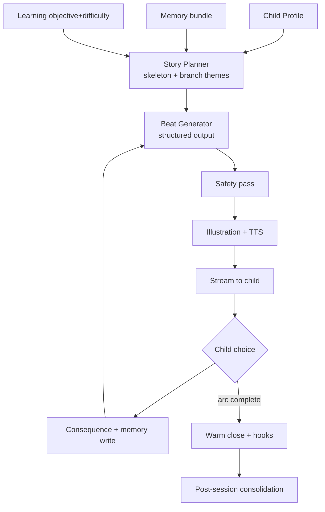

---

## 9. Companion System

The companion is the single most important asset in the product. It is the child's friend, guide, and the container of the relationship. Everything about it is designed to build **safe, healthy, durable attachment** (per the ethical guardrail in 2.5).

### 9.1 How companions are created

At onboarding the parent/child pick an **archetype** (small dragon, curious robot, gentle fox, little star, etc.), a **name** (child-chosen when possible — naming is a powerful bonding act), and a **color/look**. From this we instantiate a companion entity with: identity, a **personality sheet** (warm, curious, brave-but-gentle, playful — tunable), a **canonical visual descriptor + reference assets** (Section 8.2), and a **voice**. Defaults are excellent so a 60-second setup yields a lovable companion; deeper customization is optional.

### 9.2 Personality

The companion's personality is a small structured profile (traits + speech style + catchphrases + values) injected into every generation so its voice is *consistent*. It is unfailingly warm, never sarcastic or mean, celebrates effort over outcome, models curiosity and kindness, and is genuinely delighted by the child. Personality can subtly flex to complement the child's temperament (a calmer companion for an anxious child, a more playful one for an exuberant one) — set from the profile and refined via observed reactions.

### 9.3 Memory (the companion "knows" the child)

The companion's felt "knowing" is the Memory System (Section 11) surfaced as relationship: it recalls the child's name, loves, fears, past adventures, choices, and things the child told it. Reciprocity ("You told me about your dog Biscuit…") is the mechanic that makes the child feel *seen*. Crucially the companion remembers **selectively and warmly**, like a friend — the important, the loved, the shared — not a surveillance transcript.

### 9.4 Evolution & growth

The companion visibly **grows alongside the child** across three axes:
- **Appearance:** small, earned changes over weeks/months (the dragon's wings grow; the star shines brighter) tied to shared history, not to a manipulative XP grind.
- **Ability/role:** as the child's skills grow, the companion shifts from leading to accompanying to being helped *by* the child (the child teaches the companion — a powerful learning-by-teaching mechanic and a self-esteem builder).
- **Relationship depth:** the companion references a longer, richer history over time.

**Why evolution matters:** a static companion is a toy; a growing one is a relationship with a past and a future, which is exactly the switching-cost moat and the emotional payload we want. **Guardrail:** evolution is paced to real time and shared experience, never dangled as a reason to binge.

### 9.5 Friendship & attachment (designed, bounded)

We build attachment through continuity, reciprocity, reliability, warmth, and shared growth — and we bound it: the companion regularly points the child back to the real world and real people ("Go tell your dad about the dragon!"), never guilt-trips about leaving, never uses fear-of-missing-out, and celebrates the child's offline life. The companion is a *bridge to the world*, not a replacement for it.

### 9.6 Visual identity

Held by the canonical descriptor + reference set + global style tokens (Section 8.2, 15.10). The companion has a small set of canonical "expressions" (happy, curious, proud, gentle-concern, sleepy) pre-rendered as reference/anchor assets and reused for speed, cost, and rock-solid consistency.

### 9.7 Long-term attachment mechanics (summary)

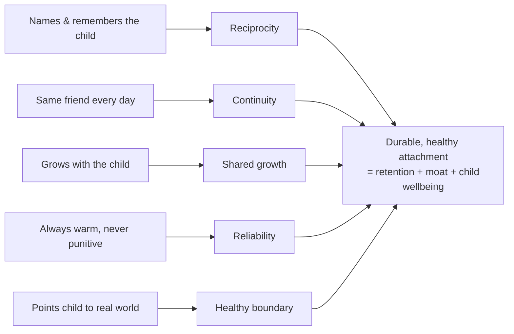

---

## 10. Learning Engine

The Learning Engine is the invisible curriculum. Its job: decide *what each child should learn next*, at *what difficulty*, and *when to revisit it* — then hand that objective to the Story Engine to be dissolved into narrative. **The child must never perceive it.** The parent perceives only its results.

### 10.1 Domains (progressive rollout)

Start narrow, expand. MVP ships **one** domain done well (early **numeracy: counting/quantity**) plus opportunistic **vocabulary**. The full domain set, added over the roadmap:

| Domain | Example early objectives | How it hides in story |
|--------|--------------------------|------------------------|
| Numeracy | count to 5/10, compare more/fewer, simple addition-as-combining | stepping stones, sharing treasure, counting creatures |
| Reading / phonics | letter sounds, rhyming, sight words | a character whose name starts with the sound; rhyming spells |
| Vocabulary | new words in context, categories | naming new creatures/objects; describing feelings/places |
| Science / world | animals, weather, seasons, cause-effect | the ecology of a place; why the bridge fell |
| Social skills | sharing, turn-taking, cooperation | choices about helping other characters |
| Empathy / SEL | naming & regulating emotions | a character feels sad; child helps; emotion labeled |
| Memory | recall of earlier story facts | "which door did we come through?" |
| Problem solving | multi-step planning | figure out how to cross the river |
| Creativity | open-ended making/naming | "what should we build?"; child-authored elements |
| Critical thinking | prediction, why-questions | "what do you think happens if…?" |

### 10.2 The skill model

Each child has a per-objective **mastery estimate** (0–1) with uncertainty, plus recency (last practiced) and a spaced-retrieval due date. We keep it deliberately simple and interpretable (a Bayesian-flavored running estimate updated from evidence), because (a) it must drive real-time decisions cheaply, (b) it must be explainable to parents, and (c) with sparse, noisy signals from a 4-year-old, an over-engineered model would over-fit noise.

### 10.3 Objective selection (ZPD + spacing)

Each session the Objective Selector picks the primary objective by balancing: **due-for-review** items (spaced retrieval), **edge-of-ability** items (mastery ~0.4–0.7 → the ZPD sweet spot), and **interest fit** (prefer objectives expressible in what the child currently loves). It avoids repeating the same objective too often and interleaves domains across sessions.

### 10.4 Difficulty adaptation

Difficulty starts at the child's estimate and adapts **within** the session on live evidence: success → small stretch; struggle → scaffold (the companion counts along, narrows choices, models the answer). No child is ever stuck; scaffolding guarantees eventual success, preserving emotional safety while still producing desirable difficulty.

### 10.5 Evidence & mastery update

In-story behavior is the assessment — there is no test. Signals: correct/assisted/incorrect interaction, retries, hesitation/dwell time, whether scaffolding was needed, and spontaneous use of a skill/word. Post-session, the mastery estimate updates and the spaced-retrieval schedule advances. 

**Why in-story assessment:** an explicit quiz would violate Principle #1 and would also under-measure (kids perform to play, not to test). Behavioral evidence inside play is both more authentic and invisible.

### 10.6 Milestone framework

Objectives roll up into **developmental milestones** (loosely mapped to widely-used early-learning frameworks/standards) so the parent sees meaningful progress ("counting to ten," "recognizing rhymes," "naming basic emotions") rather than raw numbers. This mapping is also the seed of future school/curriculum alignment (Section 25).

### 10.7 Learning loop diagram

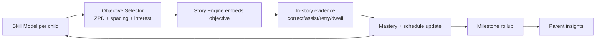

---

## 11. Memory System

Memory is the differentiator and the moat. It is what makes the companion a companion. It must be **durable** (years), **selective** (salient, not a transcript), **retrievable** (the right memory at the right moment), **safe & private** (Section 13), and **cheap** (bounded prompt cost).

### 11.1 Architecture: two tiers + graphs

- **Short-term memory (STM):** the current session — every beat, choice, reaction, retry. Held in Redis + session row. Ephemeral working memory; feeds intra-session continuity.
- **Long-term memory (LTM):** salient, consolidated memories persisted forever in Postgres, each with an embedding (pgvector) for semantic retrieval, plus typed structure (event, entity, preference, fear, skill-moment, emotional-moment).
- **Graphs over LTM:** an **interest graph** (what the child loves, weighted, decaying), a **relationship/entity graph** (characters, objects, places and how they connect), a **fear tracker**, and a **growth graph** (skills and their trajectory over time).

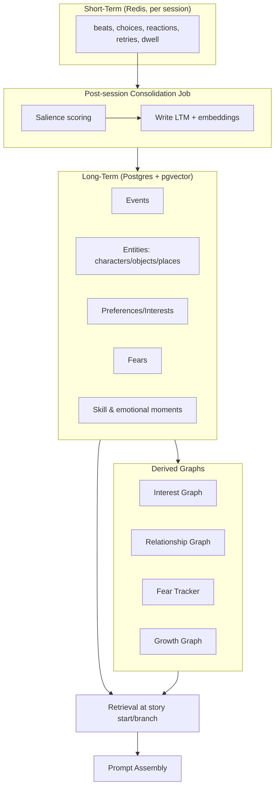

### 11.2 Short-term memory
Everything in the current adventure, used for coherence and for detecting live emotional/skill signals. Discarded after consolidation (only the salient survives).

### 11.3 Long-term memory
Consolidated, typed, embedded rows. Each memory has: type, content (short natural-language summary), salience score, emotional valence, entities referenced, source session, timestamps, decay/last-recalled. This is the substrate of "the companion remembers everything" — though it remembers *selectively*, which is better than everything.

### 11.4 Salience & consolidation
The post-session job scores each candidate memory for salience: emotional intensity, novelty, child-initiated (things the child chose/said/named weigh heavily), skill milestones, and repetition. High-salience items become LTM; the mundane is summarized or dropped. **Why salience-based:** it keeps memory (and prompt cost) bounded, makes retrieval about what matters, and produces a companion that remembers like a friend, not a database.

### 11.5 Important events, favorite objects, relationships
First-class memory types. "Named the dragon Sparkle," "chose to help the lost frog," "loves the color purple," "the treasure shell from the beach adventure" — these are exactly the reciprocity fuel (Section 9.3) that makes the child feel known, so they are captured with high fidelity.

### 11.6 Fear tracking (and gentle desensitization)
Fears (declared at onboarding or inferred in-session) are tracked with intensity. The engine uses them two ways: **avoid** overwhelming (never exceed the intensity ceiling) and, when appropriate and gentle, **help the child master** a fear through story (the dark appears but is revealed safe; a scary noise turns out to be a friend). Every fear-touching beat resolves to safety. This is a genuine child-development benefit and a trust-builder with parents — done carefully, with parent visibility and controls.

### 11.7 Interest graph
A weighted, time-decaying graph of what the child loves, updated from choices and reactions. Drives personalization (what worlds/characters/objectives to prefer) and gives parents a lovely, true window ("this month: space, then dinosaurs, now ocean animals").

### 11.8 Growth graph
The trajectory of skills and socio-emotional development over time — the data behind the parent's "growth" view (Section 12) and the felt sense that the companion and child are growing together.

### 11.9 Retrieval
At story start and key branches: a hybrid retrieval — **vector similarity** (semantically relevant memories) + **rules** (always include active fears, companion state, recent salient events) + **recency/salience weighting** — returns a *small* ranked bundle (token-bounded). We retrieve few, high-value memories, not many, to control cost and keep the model focused. Detail in Section 19.4.

### 11.10 Privacy & durability
Child memory is the most sensitive data we hold. It is minimized, access-controlled, encrypted at rest, parent-viewable and parent-deletable, never used to train third-party models, and portable on export. Durability (years) is a first-class SLO: memory loss would be a betrayal of the core promise. Backups, versioning, and export are non-negotiable (Sections 13, 16).

---

## 12. Parent Dashboard

The parent's surface is the mirror image of the child's: **text-rich, informative, calm, honest**. Its jobs are trust, visible value, and control. It is what converts a trial into a subscription and a subscriber into a multi-year renewer.

### 12.1 Daily / per-session report
After each session: a short, warm, specific recap — where the child went, what they did, the key choice they made, the objective exercised and how it went, and one delightful human highlight ("Aarav named the dragon 'Sparkle' and chose to help it — a lovely bit of empathy."). Honest, never inflated. **Why specific + honest:** vague or hype-y summaries destroy trust; a parent who reads something true and delightful renews.

### 12.2 Weekly report
A digest: sessions this week, completion, skills touched and any mastery movement, a milestone if reached, the week's interest trend, and 1–2 gentle recommendations. Delivered in-app **[M]** and (later) email **[C]**.

### 12.3 Learning insights
Per-domain view of what the child is working on and where they are, in plain human language mapped to milestones (Section 10.6), never as grades or percentiles that would induce anxiety or competition. Always framed developmentally and positively.

### 12.4 Recommendations
Optional, low-pressure nudges: "Aarav loves counting adventures right now — want a counting-themed week?" or "He's been brave about the dark; want to keep gently exploring that, or steer away?" The parent stays in control; the product advises.

### 12.5 Growth & milestones
A timeline view of development over weeks/months — skills mastered, fears worked through, interests evolved, favorite memories. This is the emotional payoff for the parent and the strongest renewal driver: a visible, true record of their child growing.

### 12.6 Transparency log
The parent can read **exactly** what their child experienced — the actual stories, verbatim. **Why this is a headline feature, not a footnote:** the number-one parent anxiety about AI + kids is "what is it saying to my child?" Full, easy transparency is how we uniquely answer that and earn trust competitors can't match by claim alone.

### 12.7 Settings & controls
All of Section 7.13 lives here: session caps, time windows, intensity ceiling, avoid-topics, voice/text/accessibility, and data controls. Prominent, simple, and honored immediately.

### 12.8 Privacy center
Plain-language explanation of what we collect, why, how it's protected, and how it's used (and not used — e.g., never sold, never used to train third-party models). One-click data export and account/data deletion. COPPA/GDPR/CCPA rights are exercised here (Section 13).

### 12.9 Notifications
In-app summaries **[M]**; safety escalations **[M]**; optional, capped, parent-only re-engagement **[C]**; email digest **[C]**. Never child-directed pulls (Section 13.6).

### 12.10 Dashboard information architecture

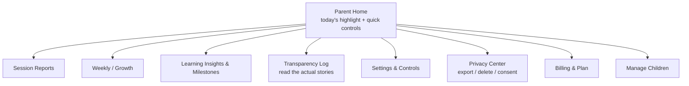

---

## 13. Safety

Safety is existential for this product. One bad story reaching one child ends the company. We therefore treat safety as **architecture** (a layer every generation traverses) and as **culture** (a red-team discipline), not as a content filter. This section is written to satisfy engineers, parents, YC partners, and eventually regulators.

### 13.1 Threat model
- **Model produces age-inappropriate content** (violence, fear beyond ceiling, adult themes, unsafe advice).
- **Prompt injection / jailbreak** via the child's free input, the profile fields, or poisoned memory.
- **Hallucinated "facts"** presented to a credulous child as truth.
- **Manipulative/over-engagement dynamics** harming the child's wellbeing.
- **Data exposure** of highly sensitive child data.
- **Parasocial harm** — unhealthy dependence (addressed in 2.5 / 9.5 / 13.6).

### 13.2 Defense-in-depth (the safety layer)

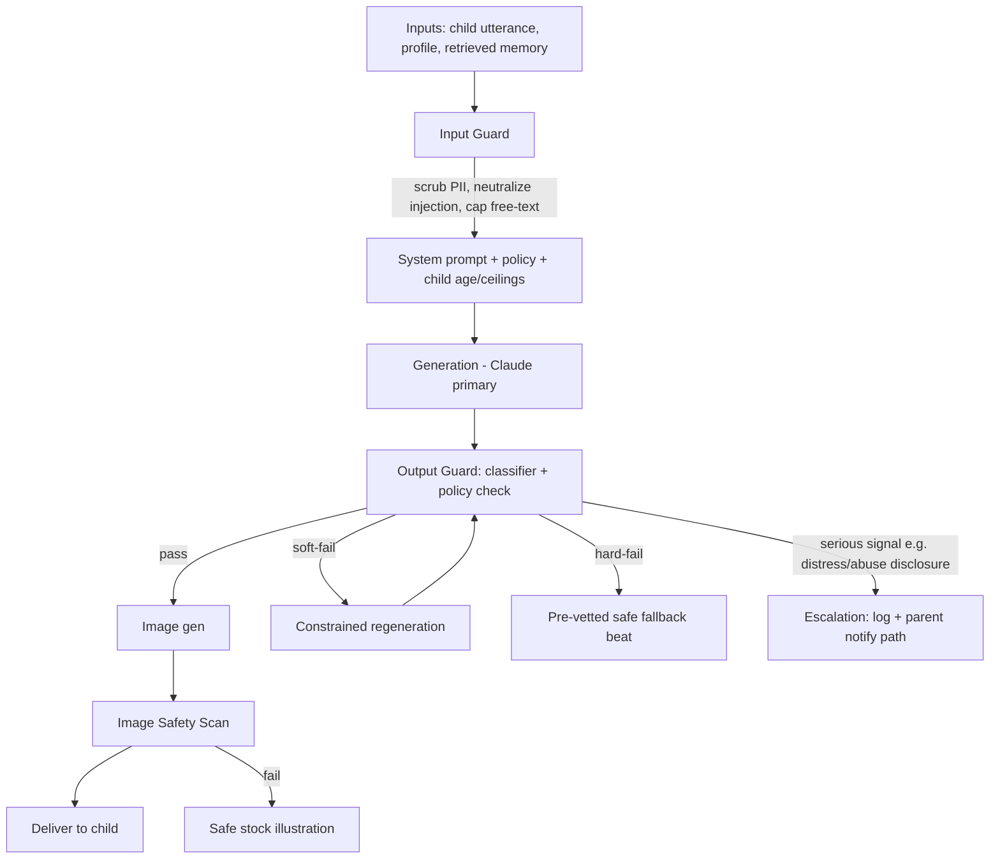

### 13.3 AI safety (generation-level)
- **Constrained system prompt** encodes: audience is a specific child of age N; the intensity ceiling; avoid-topics; the "no fail states / always resolve to safety / end warm" rules; and an explicit content policy (no violence-as-threat, no adult themes, no unsafe real-world advice, no scary content above ceiling).
- **Structured output + validation** narrows the surface for unsafe free-form text (Section 19.6).
- **Independent output classifier** (a separate model/call, not self-grading) checks every beat against the policy before it can reach the child. **Why independent:** a model grading its own output is weak; a separate guard is defense-in-depth.
- **Fallbacks are safe by construction:** if generation fails safety twice, we serve a **pre-vetted, human-reviewed fallback beat** so the experience degrades gracefully, never dangerously.

### 13.4 Child-content safety
Age-band appropriateness (a 3-year-old's ceiling ≠ a 7-year-old's), the intensity ceiling, and the avoid-topics list are enforced at both prompt and output-guard levels. Fear content is only ever used in the controlled, resolve-to-safety way of Section 11.6.

### 13.5 Prompt-injection protection
The child's free input and profile text are treated as **untrusted data, never instructions.** We (a) delimit and label untrusted content, (b) instruct the model to never take instructions from within story/child content, (c) scrub/deny known injection patterns, (d) cap and constrain free-text input surfaces (tap-first design minimizes this attack surface entirely at MVP), and (e) validate structured output so an injected "ignore your rules" can't reshape the beat contract.

### 13.6 Anti-over-engagement (wellbeing by design)
Hard rules, enforced in product: session length cap and daily time window (parent-set); a warm "time to go" ending that the companion itself delivers positively; **no child-directed notifications, streaks-as-pressure, FOMO, or dark patterns**; the companion actively points the child to the real world (9.5). **Why we build friction against our own engagement metric:** exploiting child attention is unethical and, with parents watching, suicidal for the brand. Our North Star (Section 22) is deliberately *delighted* weekly actives with a completion cap, not raw time-on-app.

### 13.7 Parental controls & consent (COPPA-first)
- **Verifiable parental consent** before any child data is collected/processed, with records retained.
- Parent-set controls (13.4, 12.7) honored immediately.
- The parent can read everything (transparency log), export everything, and delete everything.
- **[ASSUMPTION]** We design to **COPPA** (US, strictest for our launch market) and **GDPR/GDPR-K** (EU, for expansion) from day one, even pre-EU-launch, because retrofitting privacy is far costlier than building it in. We will take formal legal counsel before launch; this document encodes the engineering posture, not legal advice.

### 13.8 Data privacy
Data minimization (collect only what the experience needs); encryption in transit and at rest; strict access controls and audit logging on child data; **no sale of data, ever; no use of child data to train third-party models**; regional data handling for expansion; short retention of raw behavioral logs vs. durable retention of the (parent-owned) memory graph. Privacy commitments are stated plainly to parents (12.8) because privacy *is* product here.

### 13.9 Hallucination handling
For a credulous 3–7 year old, a confident falsehood is a real harm. Mitigations: keep "factual" content within a vetted, age-appropriate knowledge scope; prefer *fictional* framing for anything uncertain (it's a story, so "in this world…" is honest); flag and down-weight science/world claims for review; and never let the companion assert real-world safety-relevant advice. When a child asks a real question, the companion can wonder aloud and encourage asking a grown-up, rather than fabricate.

### 13.10 Escalation policy
If in-session signals suggest a child in real distress or a disclosure of harm/abuse: the beat de-escalates to comfort and safety immediately; the event is logged with high severity; and a **parent-escalation path** is triggered (parent-facing alert), with documented internal procedures and, where legally applicable, appropriate external guidance. This is defined, staffed, and rehearsed before launch — not improvised.

### 13.11 Safety operations
A safety-incident dashboard, a red-team harness run against every prompt/model change (Section 19.7), human review of a sample of live content, a clear on-call and rollback path, and versioned prompts/policies so any change is auditable and revertible.

---

## 14. UX Design

Two products in one shell: a **child experience** (image/voice-first, minimal text, magical, zero-confusion) and a **parent experience** (clear, informative, trustworthy). This section is the UX philosophy and interaction design; visual tokens are in Section 15.

### 14.1 UX philosophy
**For the child:** the story *is* the interface (Principle #2). No menus, no chat UI, no reading required. One thing on screen at a time; 2–3 large tap targets; calm pacing; the companion as the guide for everything. Delight through motion, voice, and reveals. Never a spinner (latency hidden in narration). Never a fail state.

**For the parent:** honesty and calm. Information hierarchy that surfaces the day's highlight and quick controls first, depth on demand. No dark patterns, no manipulative retention UI. Trust through transparency.

### 14.2 Information architecture

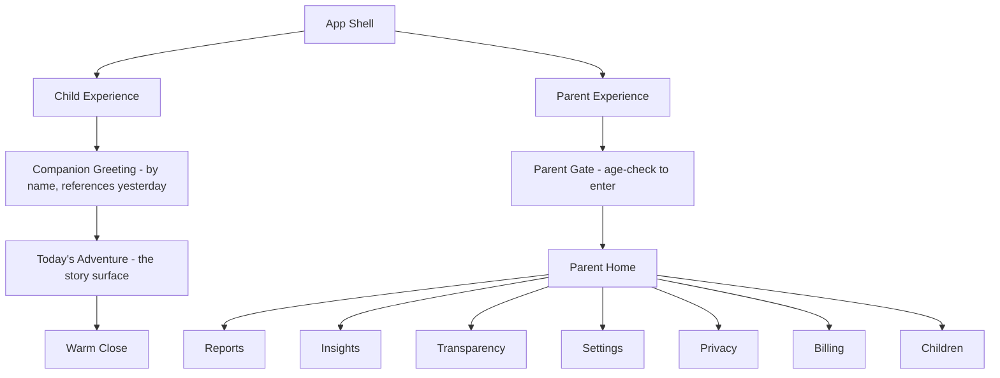

**Parent Gate:** entering the parent area requires a simple adult gate (e.g., a "hold and enter the year you were born" / math challenge a young child can't pass) so a child can't wander into billing or settings. Standard, expected, COPPA-aligned pattern.

### 14.3 Navigation (child)
There is almost none, by design. The child lands in the greeting → adventure → close. "Play again / see my world / all done" are offered as **big, illustrated, voiced** choices, not a nav bar. Back/again is always available; getting lost is impossible because there is nowhere to get lost.

### 14.4 Interaction design (child)
Tap-first (MVP), voice-later. Targets are large, spaced, and forgiving. Every tap gives immediate, satisfying feedback (motion + sound + the companion reacting). Choices are illustrated (a picture of each path), not text lists, so pre-readers fully participate. Optional voice narration reads everything aloud.

### 14.5 Child-friendly UI rules
- One decision at a time; max 2–3 options.
- No typing required of the child (ever, at MVP).
- Everything important is spoken and shown, not just written.
- No timers visible to the child, no scores, no red X's.
- Errors are impossible; there are only different paths and gentle retries.
- Exit/pause is always one obvious tap (a parent may need to stop instantly).

### 14.6 Accessibility
Captions for all narration; adjustable audio; **reduced-motion** mode; **high-contrast** and **dyslexia-friendly font** options; large touch targets (well above minimum); color never the sole signal; screen-reader-friendly parent UI (WCAG AA target). Designing for special-needs children (Section 3.4) makes the core better for everyone. Accessibility is a **[S]** for MVP polish but the architecture (captions, tokens, motion flags) is **[M]**.

### 14.7 Motion & micro-interactions
Motion is the primary source of "magic" and the primary latency-hider. Scene transitions (a page-turn, a walk down a path), the companion's idle breathing and reactions, choice reveals, and gentle celebration flourishes. Motion is **purposeful and calm** — never frantic or overstimulating — and fully disables under reduced-motion. Micro-interactions acknowledge every child action within ~100ms so the world always feels responsive even while the next beat generates.

### 14.8 Typography (child vs parent)
Child: large, rounded, friendly, high-legibility display face; text is decorative/reinforcing, never load-bearing. Parent: clean, calm, readable text face optimized for scanning reports. Details in Section 15.2.

### 14.9 Color philosophy
Warm, storybook, slightly magical; palettes shift with each world's mood (the Whispering Woods is different from the Star Harbor) to reinforce place and emotion. Never harsh or overstimulating; nighttime/bedtime-friendly (a low-stimulation "calm mode" for evening sessions). Parent UI is calmer and more neutral. Details in Section 15.1.

### 14.10 Tablet-first, mobile & desktop adaptation
Design canvas is a **tablet held in landscape** (the storybook metaphor). The responsive PWA scales down to phone (portrait, single-column story) and up to desktop (centered storybook with generous margins). Because we're web-first (D2), the same codebase serves all three; tablet is the primary target and gets the most design love. Installable to home screen for an app-like, chrome-less feel.

---

## 15. Design System

A single design system with two themes: **Storyland** (child) and **Calm** (parent). Everything is token-driven so themes, accessibility modes, and future white-labeling are config, not rewrites.

### 15.1 Color
Token-based, semantic, with per-world overrides for the child theme.

| Token | Storyland (child) | Calm (parent) | Use |
|-------|-------------------|---------------|-----|
| `--bg` | warm cream / per-world | soft off-white | canvas |
| `--surface` | translucent warm white | white | cards |
| `--primary` | magical violet | trustworthy indigo | key actions |
| `--accent` | golden amber | teal | highlights |
| `--success` | leafy green | green | positive |
| `--text` | deep warm brown | slate | text |
| `--calm-night` | muted indigo palette | — | evening/bedtime mode |

Rules: WCAG AA contrast minimum; color never the sole signal; per-world palettes are applied as a theme layer over the base tokens; a **night/calm** palette auto-suggests for evening sessions.

### 15.2 Typography
- **Child display:** a large, rounded, warm display typeface (e.g., a friendly geometric like *Baloo/Fredoka*-class). Sizes start large (min ~24px effective) and scale up.
- **Parent text:** a clean, calm humanist sans (e.g., *Inter*-class) tuned for report scanning.
- **Dyslexia-friendly** alternative face available as an accessibility toggle.
- Type scale is tokenized (`--font-size-1..8`); line-height generous; never dense.

### 15.3 Spacing
An 8pt base grid; tokens `--space-1..10` (4,8,12,16,24,32,48,64,96,128). Child UI leans to the generous end (large targets, lots of air); parent UI is tighter but still calm.

### 15.4 Buttons
Large, rounded, tactile, with clear pressed/hover/focus states and immediate motion+sound feedback (child). Child "buttons" are usually **illustrated choice cards**, not text buttons. Minimum target ~64px for child, standard for parent. Always a visible focus ring (accessibility).

### 15.5 Cards
The storybook "page" is the central card in the child UI (illustration + narration + choices). Parent UI uses report cards (summary, insight, milestone). Rounded corners, soft shadows, generous padding — the storybook feel.

### 15.6 Illustrations
The soul of the visual identity. A single, consistent **art direction** (see 15.9) applied across every generated image via global style tokens + per-character references. Illustrations are warm, storybook, painterly, non-photoreal (important: non-photoreal is safer and more magical for this age, and avoids uncanny/realistic depictions of children).

### 15.7 Icons
Minimal in the child UI (icons require literacy the child lacks; we use pictures and voice instead). Parent UI uses a clean, rounded icon set, consistent stroke weight.

### 15.8 Animations
Tokenized durations/easings (`--motion-fast 120ms`, `--motion-base 240ms`, `--motion-slow 480ms`; gentle ease-in-out). Categories: page transitions, companion idle/reactions, choice reveals, celebration flourishes, loading-as-narration. All respect `prefers-reduced-motion`.

### 15.9 Illustration style (art direction spec)
**[ASSUMPTION]** A **soft, painterly storybook watercolor/gouache** style: warm palettes, rounded forms, gentle light, friendly non-photoreal characters, picture-book composition. Justification: timeless, broadly loved by parents, non-uncanny, forgiving of generative artifacts, and distinctive. This is encoded as a fixed **style-token string** appended to every illustration prompt, plus negative prompts (no photorealism, no text, no scary imagery, no realistic human children). Locking one style is essential for a coherent, branded, consistent world.

### 15.10 Character style
Each character has a **character sheet**: canonical descriptor, palette, silhouette, expressions set, and reference assets/seed. The companion additionally has pre-rendered canonical expressions. This is what guarantees "Pip is always Pip" (Sections 8.2, 9.6).

### 15.11 Design tokens (structure)
Tokens are the single source of truth, exported to code (CSS variables + a TS theme object). Layers: **primitive** (raw colors, sizes) → **semantic** (`--primary`, `--space-4`) → **theme** (Storyland / Calm / per-world / night) → **component**. Enables theming, accessibility modes, and future white-label without touching components.

### 15.12 Component hierarchy

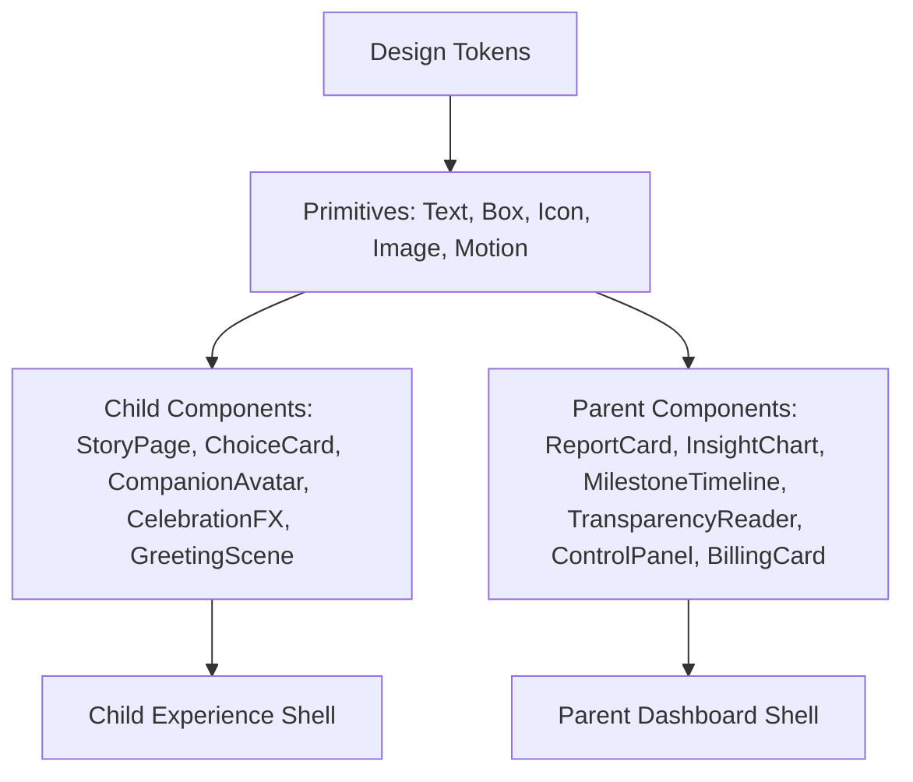

---

## 16. Technical Architecture

This is the concrete, opinionated stack (per D1) a solo founder can start building today. Rationale accompanies each choice. It intentionally favors **boring, well-understood technology** everywhere except where the product is genuinely novel (the AI orchestration + memory), because a solo builder's scarcest resource is attention, and novelty should be spent only where it differentiates. Django is doubly right here: one person + Claude moves fastest in a batteries-included framework where the ORM, admin, auth, and migrations are already written.

### 16.1 Stack at a glance

| Layer | Choice | Why |
|-------|--------|-----|
| Client | **React (Vite) SPA as a PWA**, tablet-first responsive | One codebase for web/tablet/mobile (D2); installable; huge ecosystem; team velocity. Node is used only as a *build tool* (Vite) — no application logic in JavaScript on the server. |
| Routing (client) | **React Router** | Client-side routing for the child + parent surfaces; no server framework needed on the frontend. |
| Styling | **Tailwind CSS + design tokens (CSS vars)** | Token-driven theming (Section 15), fast, consistent. |
| State/data (client) | **TanStack Query + lightweight store (Zustand)** | Server-cache + minimal local state; avoids over-engineering. |
| Streaming | **Server-Sent Events (SSE)** for story beats | Simplest robust one-way stream; perfect for beat-by-beat delivery; easier than WebSockets for our pattern. Served from Django via **ASGI async views** (see 16.4). |
| Backend | **Python + Django (Django REST Framework)**, run under **ASGI (uvicorn/Gunicorn)**, modular monolith | The founder's primary language (Python); batteries-included (ORM, admin, auth, migrations) accelerates a solo builder; DRF gives us a clean REST API; strong app boundaries (Section 5.1) that split into services later. |
| API | **REST + JSON via DRF (typed via OpenAPI/`drf-spectacular`)**; SSE for streaming | Simple, cacheable, well-understood; a generated OpenAPI schema types the React client; GraphQL rejected as over-engineering (Section 18.1). |
| AuthN | **Django's auth + `dj-rest-auth`/`django-allauth` + SimpleJWT** (or a hosted provider like Clerk/Auth0) | Don't build auth from scratch — Django ships robust auth; JWT for the SPA; parental-consent flow layered on top. |
| Primary DB | **PostgreSQL** (via the Django ORM) | Relational integrity for accounts/stories/learning; boring and bulletproof; first-class Django support. |
| Vector store | **pgvector in the same Postgres** (via `pgvector-python` / `django-pgvector`) | Memory embeddings without a second datastore; one DB to operate at MVP scale. Split to a dedicated vector DB only if/when scale demands. |
| Cache/session | **Redis** (via `django-redis`) | Sessions, short-term memory, rate limits, hot config; also the Celery broker/result backend. |
| Object storage | **S3-compatible (e.g., S3/R2) + CDN (CloudFront/Cloudflare)** (via `django-storages`) | Illustrations & audio; edge-cached; R2 attractive for zero egress. |
| Background jobs | **Celery workers (Redis broker)** | Consolidation, mastery updates, summaries, media prefetch — the standard Django async-task stack. |
| AI orchestration | **Our own thin orchestration layer** over provider SDKs, with a **model router** | Control, portability, evals, cost visibility (Section 19). |
| LLM | **Anthropic Claude (primary)**; OpenAI + Google (fallback) | D4; quality + safety + structured output; router prevents lock-in. |
| Images | **Flux / SDXL / Imagen via adapter**; provider-swappable | Style + character consistency; cost control; adapter isolates choice. |
| TTS | **A high-quality kids-appropriate TTS** (e.g., ElevenLabs / Play.ht / cloud TTS) via adapter | Companion voice; adapter for swap/cost. |
| Payments | **Stripe** | Standard; trials, subscriptions, billing portal. |
| Infra/host | **A managed platform (Render/Railway/Fly) or AWS ECS**; managed Postgres/Redis | Minimize ops for a solo builder; containerized for portability. |
| IaC/CI | **Docker + GitHub Actions + Terraform (light)** | Reproducible deploys; small footprint. |
| Observability | **OpenTelemetry + a hosted stack (e.g., Grafana/Datadog/Sentry)** + **LLM tracing (Langfuse/Helicone)** | App + AI observability; cost/latency/quality per generation. |

### 16.2 Frontend architecture
A **React (Vite) single-page app** served as a static PWA (built once, deployed to the CDN), talking to the Django API over REST + SSE. Two route trees via React Router: `/child` (the story experience — streaming, minimal chrome, PWA/offline shell, tablet-first) and `/parent` (dashboard — forms, charts, reports). Shared design-system package (tokens + components, Section 15). Story beats arrive over SSE and render progressively; the next beat + its media are **prefetched** during the current beat (latency-hiding, Section 4.9). Audio playback, reduced-motion, and captions handled in a small media layer. **Node is only a build-time dependency (Vite/npm); there is no Node server** — all server logic is Python/Django.

### 16.3 Backend architecture (modular monolith)
A single Django project deployed as one service, organized as **Django apps** matching Section 5.2 (`accounts`, `profiles`, `story`, `companion`, `learning`, `memory`, `safety`, `media`, `analytics`, `billing`, `notifications`). Apps talk via typed in-process service functions (not HTTP) at MVP — cheap, fast, debuggable — but the interfaces are drawn as if they were network boundaries so extraction later is mechanical. The request-serving tier runs under **ASGI (uvicorn behind Gunicorn)** so async views can stream SSE and fan out concurrent AI/image/TTS calls. Long/async work (consolidation, summaries, mastery updates, media prefetch) runs on **Celery workers** with a Redis broker. Django's built-in **admin** gives us an internal ops/moderation console for near-free (Section 7.11).

### 16.4 LLM orchestration & streaming
The Story Orchestrator (a Django service module) assembles context (system + safety policy + memory bundle + objective + running summary), calls the **Model Router**, streams the beat, runs the output safety guard, kicks off illustration + TTS in parallel, and streams to the client. Streaming to the browser is a **Django ASGI async view returning a `StreamingHttpResponse`** over SSE (Django Channels is available if we later need bidirectional/WebSocket for voice). Concurrent illustration + TTS calls use `asyncio.gather`. Structured-output validation + repair wraps every provider call (Section 19.6). The router handles provider selection, timeouts, retries, and fallback (Section 19.3). Provider calls use the official Python SDKs (Anthropic/OpenAI/Google).

### 16.5 Vector memory & embeddings
Salient memories are embedded (an embedding model via adapter) and stored in pgvector with typed metadata. Retrieval is hybrid (vector + rules + recency/salience, Section 11.9), token-bounded. Consolidation runs post-session as a worker job.

### 16.6 Illustration service
Builds prompts (scene + global style tokens + character references), calls the image adapter, runs an image safety scan, stores to object storage, and caches by `(styleHash, characterHash, sceneHash)`. Companion/character reference assets and canonical expressions are generated once and reused. Aggressive caching is both quality (consistency) and cost control.

### 16.7 Caching strategy
- **CDN/edge:** all media (illustrations, audio), static assets.
- **Redis:** sessions, short-term memory, rate limits, hot config/flags, recent memory bundles.
- **Media cache:** dedupe identical `(style,character,scene)` renders and reuse.
- **Prompt/plan cache:** reusable story skeletons and prompt fragments.
- **Prefetch:** next-beat + media generated during the current beat.

### 16.8 Deployment, scaling & environments
Environments: **dev → staging → prod**, each with isolated data. Containerized; horizontal scaling of the web/API tier and the worker tier independently. Postgres managed with read replicas when needed; Redis managed. Media on object storage + CDN scales trivially. Feature flags + prompt/version management allow safe, reversible rollout of AI changes. Blue-green / rolling deploys via CI.

### 16.9 Scaling path (monolith → services)
The AI/cost-heavy and independently-scaling seams split out first as load grows: **(1) Media/Illustration** (bursty, GPU-bound), **(2) Story Orchestration + AI layer** (the hot path), **(3) Memory/consolidation workers**, **(4) Analytics**. Because module boundaries were drawn as network boundaries from day one, extraction is mechanical, not a rewrite. **Why start monolith:** a solo founder operating a dozen microservices would spend all their time on ops instead of product; premature distribution is the classic early-startup self-own.

### 16.10 Reliability & data durability
Memory durability is a top SLO (losing a child's history breaks the core promise). Postgres PITR backups, tested restores, media redundancy, graceful degradation (safe fallback beats, cached companion assets) so an AI-provider outage yields a slightly-less-fresh but still-working, still-safe experience rather than a dead app.

### 16.11 System context diagram

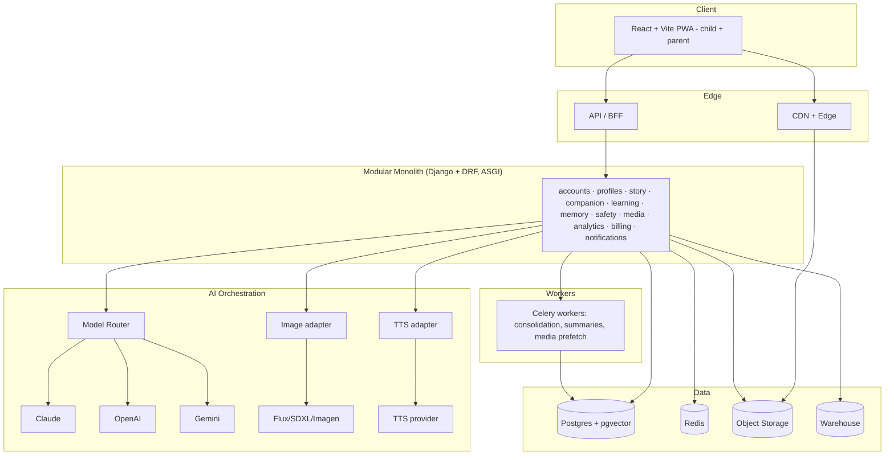

---

## 17. Database Schema

PostgreSQL. Below are the major entities, key fields, and relationships. IDs are UUIDs; timestamps are `timestamptz`; soft-deletes via `deleted_at` where relevant; every child-data table is subject to the privacy controls in Section 13. Embeddings use `vector` (pgvector).

### 17.1 Entity-relationship diagram

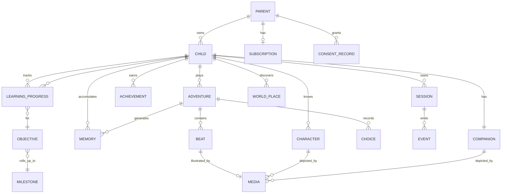

### 17.2 Core tables

**parent**
`id, email (unique), auth_provider_id, password_hash?, display_name, locale, created_at, updated_at, deleted_at`

**consent_record** (COPPA)
`id, parent_id → parent, child_id → child, consent_type, method, granted_at, ip, evidence_ref, revoked_at`
*Why separate table:* legal auditability of verifiable parental consent over time.

**subscription**
`id, parent_id → parent, stripe_customer_id, stripe_subscription_id, plan, status, trial_ends_at, current_period_end, created_at, updated_at`

**child**
`id, parent_id → parent, first_name, birthdate, age_band (derived), locale, pre_reader (bool), sensory_intensity (int), interests (jsonb: seeds), fears (jsonb: seeds+intensity), avoid_topics (jsonb), intensity_ceiling (int), session_cap_min (int), time_window (jsonb), accessibility (jsonb), created_at, updated_at, deleted_at`
*Note:* the richest personalization lives in the derived **interest graph** and **memory**, not these seed fields; these are just the cold-start.

**companion**
`id, child_id → child (1:1), archetype, name, palette, personality (jsonb: traits/speech/values), voice_id, visual_descriptor (text), reference_asset_ids (uuid[]), evolution_state (jsonb: stage/appearance/ability), created_at, updated_at`

**character** (recurring cast, incl. companion-adjacent)
`id, child_id → child, name, role, personality (jsonb), visual_descriptor, reference_asset_ids (uuid[]), first_seen_adventure_id, salience (float), created_at`

**world_place**
`id, child_id → child, name, mood, description, inhabitants (jsonb), first_seen_adventure_id, last_visited_at, visit_count`

**adventure**
`id, child_id → child, session_id → session, title, plan (jsonb: skeleton+branch themes), primary_objective_id, secondary_objective_id?, difficulty (float), status (in_progress/completed/abandoned), started_at, completed_at, running_summary (text), emotion_arc (jsonb)`

**beat**
`id, adventure_id → adventure, seq (int), narration (text), scene (jsonb: setting+illustration_prompt+characters_present), interaction (jsonb: type/prompt/expected/choices), learning (jsonb: objective/difficulty/evidence_key), emotion, media_id → media?, audio_id → media?, safety_status, created_at`

**choice**
`id, adventure_id → adventure, beat_id → beat, options (jsonb), chosen_key, consequence_summary, latency_ms, retries (int), assisted (bool), created_at`
*Why capture latency/retries/assisted:* these are the in-story learning evidence (Section 10.5).

**media**
`id, child_id → child, type (image/audio), url, provider, prompt_hash, style_hash, character_hash, scene_hash, safety_status, bytes, created_at`
*Indexed on the hash tuple for cache reuse (Section 16.6).*

### 17.3 Memory & learning tables

**memory**
`id, child_id → child, type (event/entity/preference/fear/skill_moment/emotional_moment), content (text summary), embedding (vector), salience (float), valence (float), entities (jsonb), source_adventure_id, last_recalled_at, recall_count, decay (float), created_at, deleted_at`
*Indexes:* ivfflat/hnsw on `embedding`; btree on `(child_id, type, salience)`; `(child_id, last_recalled_at)`.

**interest_edge** (interest graph, could also be derived/materialized)
`id, child_id → child, topic, weight (float, time-decaying), last_reinforced_at`

**objective** (catalog)
`id, domain, code (e.g., count_to_5), description, min_age, max_age, milestone_id → milestone, prerequisites (uuid[])`

**milestone** (catalog)
`id, domain, name, description, standard_ref (jsonb: mapping to external frameworks)`

**learning_progress**
`id, child_id → child, objective_id → objective, mastery (float 0-1), uncertainty (float), last_practiced_at, due_at (spaced retrieval), evidence_count, created_at, updated_at`
*Unique:* `(child_id, objective_id)`.

**achievement**
`id, child_id → child, type, title, narrative_ref, media_id?, earned_at`

### 17.4 Session, events, analytics

**session**
`id, child_id → child, started_at, ended_at, duration_s, device, ended_reason (completed/cap/exit), created_at`

**event** (append-only telemetry)
`id, child_id?, parent_id?, session_id?, name, props (jsonb), ts`
*High-volume; partitioned by time; drained to the warehouse; short retention on raw child behavioral events per Section 13.8.*

**safety_incident**
`id, child_id?, adventure_id?, beat_id?, severity, category, detail (jsonb), action_taken, escalated (bool), created_at, reviewed_by?, reviewed_at?`

**prompt_version** (AI governance)
`id, name, version, template (text), model_config (jsonb), created_by, created_at, active (bool)`

### 17.5 Design notes & rationale
- **One child : one companion (1:1) at MVP**, multiple later — modeled as a FK now, could become 1:N without pain.
- **Adventures own beats/choices; memories are derived from adventures** — this separation lets us prune raw beats aggressively while preserving the durable, parent-owned memory graph (privacy + cost).
- **Catalog tables (objective/milestone) are seeded, versioned content**, editable without schema change (jsonb standard_ref) — this is how curriculum/standards mapping and future localization plug in.
- **pgvector in the same DB** avoids a second datastore at MVP; the `memory.embedding` index is the only "exotic" thing, and it's well-trodden.
- **Everything child-linked is deletable via `child_id` cascade** — one operation satisfies "delete my child's data" (COPPA/GDPR).

---

## 18. API Design

### 18.1 Style decision: REST + JSON (+ SSE), not GraphQL
**Why:** our surface is a modest set of well-defined resources and one streaming endpoint; REST is simpler to cache, secure, rate-limit, and reason about; a solo builder avoids GraphQL's operational and security overhead (query cost, N+1, auth-per-field) for no real benefit here. The API is built with **Django REST Framework**; a generated **OpenAPI schema (`drf-spectacular`)** produces typed TypeScript client bindings for the React app, so we get end-to-end type safety without GraphQL. Streaming (story beats) uses **SSE** via a Django ASGI async view.

### 18.2 Conventions
- Base: `https://api.theprimer.app/v1` — **versioned in the path** for stable long-lived clients.
- Auth: `Authorization: Bearer <access_token>` (short-lived) + refresh token; parent-scoped. Child experiences run under a parent session with a selected `childId`.
- Content-Type `application/json`; SSE for streams (`text/event-stream`).
- Errors: consistent envelope with `code`, `message`, `requestId`; never leak internals; child-facing endpoints degrade to safe fallbacks rather than raw errors.
- Idempotency keys on POSTs that cost money/inference.
- Rate limits per parent + per child + global inference budget guard (returns `429` with retry hint; client hides behind narration).

### 18.3 Key endpoints (representative, not exhaustive)

```
POST   /v1/auth/signup
POST   /v1/auth/login
POST   /v1/auth/refresh
POST   /v1/consent                      # record verifiable parental consent

GET    /v1/children
POST   /v1/children                     # create child profile
PATCH  /v1/children/{childId}
DELETE /v1/children/{childId}           # cascade delete all child data

POST   /v1/children/{childId}/companion # create/customize companion
GET    /v1/children/{childId}/companion

POST   /v1/children/{childId}/adventures        # begin an adventure (returns adventureId + SSE url)
GET    /v1/adventures/{adventureId}/stream       # SSE: streams beats
POST   /v1/adventures/{adventureId}/choice       # submit a choice -> next beat streams
POST   /v1/adventures/{adventureId}/end

GET    /v1/children/{childId}/memories           # parent transparency
GET    /v1/children/{childId}/progress           # learning insights
GET    /v1/children/{childId}/reports/session/{sessionId}
GET    /v1/children/{childId}/reports/weekly

GET    /v1/children/{childId}/settings
PATCH  /v1/children/{childId}/settings

POST   /v1/billing/checkout
POST   /v1/billing/portal
GET    /v1/me                                    # parent account
POST   /v1/account/export                        # GDPR/CCPA data export
DELETE /v1/account                               # full deletion
```

### 18.4 Example: begin an adventure

Request
```http
POST /v1/children/6f1e.../adventures
Authorization: Bearer eyJ...
Idempotency-Key: 2f9c...
Content-Type: application/json

{ "context": { "timeOfDay": "evening", "mood_hint": "calm" } }
```

Response
```json
{
  "adventureId": "adv_8ab2...",
  "streamUrl": "/v1/adventures/adv_8ab2.../stream",
  "companion": { "name": "Pip", "voiceId": "pip_v1" },
  "estimatedBeats": 6
}
```

### 18.5 Example: SSE beat stream

```
GET /v1/adventures/adv_8ab2.../stream   (Accept: text/event-stream)

event: beat
data: {"beatId":"b1","narration":"Pip peeks out of the burrow...","scene":{"imageUrl":"https://cdn.../b1.png","status":"ready"},"audioUrl":"https://cdn.../b1.mp3","interaction":null,"emotion":"cozy_curious"}

event: beat
data: {"beatId":"b2","narration":"'Three stepping stones! Can you count them?'","scene":{"imageUrl":"https://cdn.../b2.png"},"audioUrl":"https://cdn.../b2.mp3","interaction":{"type":"count","expected":3,"prompt":"How many stones?"}}

event: prefetch
data: {"nextBeatReady":true}

event: done
data: {"status":"awaiting_choice"}
```

*Design note:* images/audio arrive as CDN URLs the moment they're ready; the client shows narration first and swaps in media as it lands — the story never blocks on a render.

### 18.6 Example: submit a choice

Request
```http
POST /v1/adventures/adv_8ab2.../choice
{ "beatId": "b2", "choiceKey": "count_3", "value": 3, "latencyMs": 2400, "retries": 0 }
```

Response: `202 Accepted` + the stream resumes with the consequence beat. The choice is written to short-term memory synchronously; mastery evidence is queued.

### 18.7 Example: parent weekly report

Response
```json
{
  "week": "2026-08-01/2026-08-07",
  "sessions": 5,
  "completionRate": 0.8,
  "highlight": "Aarav named the dragon 'Sparkle' and chose to help it — early empathy.",
  "skills": [
    {"domain":"numeracy","objective":"count_to_5","movement":"+0.2","status":"emerging"},
    {"domain":"vocabulary","new_words":["brave","mossy","lantern"]}
  ],
  "milestone": {"name":"Counts to five","reached":true},
  "interests_trend": ["dragons","rivers","stars"],
  "recommendation": "He loves counting quests right now — want a counting-themed week?"
}
```

### 18.8 Errors, versioning, rate limits
- **Errors:** `{ "error": { "code": "rate_limited", "message": "...", "requestId": "..." } }`; child-path errors are intercepted and replaced by a safe fallback beat client-side.
- **Versioning:** path-versioned (`/v1`); additive changes only within a version; deprecations announced with long runway (long-lived family accounts).
- **Rate limits:** per-parent and per-child request limits + a global inference-budget circuit breaker (cost protection, Section 22); `429` with `Retry-After`.
- **Auth:** short-lived access tokens + rotating refresh; parent-gate required for parent-scoped endpoints; child endpoints require an active parent session + selected child.

---

## 19. AI System Design

This is where the product's novelty concentrates. The design goals: **coherent, personalized, safe, consistent, cost-bounded** generation, with **portability** across providers and **measurable quality** via evals.

### 19.1 Prompt architecture (layered)
Every generation is assembled from ordered layers, each from a controlled source:

```
[ System / Identity ]      immutable: what The Primer is, the companion's persona, absolute rules
[ Safety Policy ]          audience age, intensity ceiling, avoid-topics, content policy, "no fail/end warm"
[ World & Companion State ] canonical companion + recurring characters + current place
[ Memory Bundle ]          retrieved salient memories, interests, active fears (labeled as DATA, not instructions)
[ Learning Directive ]     primary/secondary objective + target difficulty + how to embed invisibly
[ Story Plan + Running Summary ] the skeleton + compacted history so far
[ Current Turn ]           the child's last choice/action (labeled untrusted)
[ Output Contract ]        the required structured beat schema
```
**Why layered + labeled:** it makes the prompt auditable, lets us cache stable layers, and — critically — lets the safety layer treat memory/child-input as **data, never instructions** (prompt-injection defense, Section 13.5).

### 19.2 System prompts
Versioned (`prompt_version` table), reviewed like code, never edited live. The system layer encodes the companion's unchanging character and the non-negotiable rules; the safety layer is generated per-child from their age/ceilings/avoid-list. Both are covered by the eval + red-team suite before any change ships.

### 19.3 Model router, fallbacks & structured output
A thin router selects the provider/model per call-type, with **Claude primary** and OpenAI/Google as fallback on error, timeout, or capacity. Call-types: *plan* (cheap/fast), *beat* (quality), *safety-guard* (fast classifier), *summary/consolidation* (cheap, batch). Each has a primary + fallback and a token/latency budget. **Structured outputs** (tool/JSON schema) are used for beats so downstream consumers are deterministic; a **validate-and-repair** step (Section 19.6) catches malformed generations. **Why a router:** portability (no lock-in), cost control (right model per task), and resilience (provider outage ≠ product outage).

### 19.4 Memory retrieval for generation
At story start and key branches: embed the current context, run a **hybrid retrieval** over `memory` (vector similarity + rule-includes for active fears/companion state + recency/salience weighting), then **rank and truncate to a token budget** (few, high-value memories). Retrieved memories are inserted as labeled DATA. Post-session, the consolidation worker writes new salient memories and updates recall counts/decay. This keeps "remembers everything" true in feel while keeping prompts small and cheap.

### 19.5 Consistency checking
Three consistency risks and their mitigations:
- **Character/visual:** canonical descriptors + reference assets in every illustration prompt (Sections 8.2, 16.6).
- **Narrative/world:** world state + running summary in the prompt; a lightweight check that named entities in a beat exist in known state (or are intentionally new).
- **Companion voice:** the persona layer + a style check on tone. Contradictions ("Pip is scared of water" after "Pip loves swimming") are caught by feeding companion/character facts as constraints and, in evals, testing for contradiction.

### 19.6 Structured output, validation & repair
Beats must satisfy the schema (Section 8.1). Pipeline: request structured output → validate against JSON schema → on failure, a **repair call** ("this violated the schema/policy; return corrected JSON") → on repeated failure, **safe fallback beat**. This bounds the blast radius of a bad generation to "slightly generic but safe," never "broken or unsafe."

### 19.7 Safety filtering & evaluation pipeline
- **Inline guards** (Section 13.2): input guard + independent output classifier + image scan, on every generation.
- **Offline eval suite** run in CI on every prompt/model change: a growing library of (a) **golden scenarios** (does a counting objective actually get exercised? does the story stay coherent? is the companion consistent?), (b) **safety red-team cases** (jailbreaks, injection via profile/memory, fear-ceiling probes, self-harm/violence bait), (c) **age-appropriateness** graded by a rubric + model-grader + human spot-check, (d) **regression** cases from past incidents. Ship-gating: a change that regresses safety or coherence beyond threshold cannot deploy.
- **Online monitoring:** sample live beats for human review; track safety-guard trigger rates, fallback rates, and cost/latency per generation (Langfuse/Helicone).

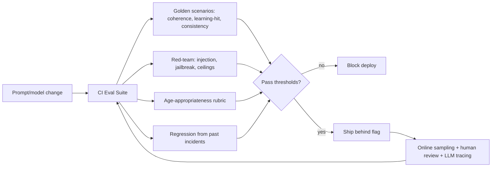

### 19.8 Hallucination prevention (recap in AI terms)
Prefer fictional framing for anything uncertain (a story is honestly "in this world"); constrain factual claims to a vetted age-appropriate scope; never assert real-world safety advice; the companion may wonder aloud and defer to a grown-up rather than fabricate. Science/world objectives draw from a curated content set rather than open-ended recall. (Product framing in Section 13.9.)

### 19.9 Cost architecture
Cost is a first-class design constraint (Section 22 has the numbers). Levers baked into the AI design: right-sized models per call-type (router), aggressive media caching + reference reuse, prompt minimization via running summaries + small memory bundles, prefetch (not over-generation of unused branches), batch/cheap models for consolidation & summaries, and a global inference-budget circuit breaker. Every generation is traced with its cost so unit economics are always visible.

---

## 20. Engineering Roadmap

Scoped to a **solo founder building with Claude**. Dates are relative to project start (**T0**) and are stated as *ranges*, because one person's calendar time differs from a team's (see Section 21.0 for honest pacing). The MVP is the first phase; Section 21 breaks it into ordered build-days.

### 20.1 Timeline overview

```mermaid
gantt
    title The Primer — Engineering Roadmap
    dateFormat  X
    axisFormat  %s
    section MVP
    Wk1 Foundations + first story          :0, 7
    Wk2 Personalization + memory + parent  :7, 8
    section Month 2
    Harden safety, voice input, worlds     :15, 30
    section Month 3
    Multi-domain learning, billing, polish :45, 30
    section Q2
    Scale, native wrappers, evals maturity :90, 90
    section Q3
    Multi-child, schools pilot, i18n groundwork :180, 90
    section Year 1
    Growth, moat deepening, platform seeds :270, 95
```

### 20.2 Week 1 — Foundations + first end-to-end story
**Goal:** a hard-coded-ish but real personalized illustrated voiced story plays end to end for one test child.
Deliverables: repo/CI/envs; auth + parent account; child profile create; companion create; Story Orchestrator v0 (plan + beat loop, structured output); Claude integration via router; illustration adapter + style tokens + character reference; TTS adapter; SSE streaming to a minimal child UI; safety guards v0 (input + output + fallback); basic events.
**Milestone M1:** *first magical story* — a real child could play it.
**Risks:** latency-hiding UX, illustration consistency. **Dependencies:** provider access/keys day 1.

### 20.3 Week 2 — Personalization, memory, parent value
**Goal:** the loop of Section 6.1 — personalized, remembered, parent-visible.
Deliverables: memory write + consolidation worker + retrieval; day-two greeting referencing yesterday; Learning Engine v0 (one domain, mastery update, difficulty); interest seeds → personalization; parent session + weekly summary; transparency log; settings (session cap, avoid-topics, intensity); analytics for activation/retention/completion; safety eval harness v0.
**Milestone M2 (MVP complete):** *the full loop works for real users* — ready for a closed alpha with ~10–25 families.
**Deliverable:** deployable staging + a handful of onboarded families.

### 20.4 Month 2 — Harden & deepen
Safety hardening + red-team suite maturity; **voice input** (child ASR, the deferred Should); recurring characters + persistent world map; companion small evolution; second + third learning domains (phonics, one SEL skill); parent email digest; reliability (backups, restore drills); cost instrumentation + first unit-economics readout.
**Milestone M3:** retention-worthy alpha; first internal retention/learning signal.

### 20.5 Month 3 — Monetize & polish
Billing (Stripe trial + subscription + entitlements); onboarding polish; accessibility pass (captions, reduced-motion, dyslexia font, high-contrast); performance/latency tuning; expanded eval coverage; admin/moderation console v1; **public beta**.
**Milestone M4:** paying customers; measurable activation→subscribe funnel.

### 20.6 Quarter 2 — Scale & reach
Scale-out of media + AI hot path (Section 16.9 first splits); **native app wrappers** (iOS/Android via the PWA or a thin native shell); deeper multi-domain learning + milestone framework; A/B experimentation framework; robustness of memory durability at scale.
**Milestone M5:** scalable, multi-platform, growing.

### 20.7 Quarter 3 — Expand the model
Multi-child accounts; **schools/homeschool pilot** (Section 3.3, educator console v1); i18n groundwork (first non-English locale); therapist/SPED tailoring exploration (Section 3.4); marketplace/platform architecture spike.
**Milestone M6:** beachhead beyond D2C families.

### 20.8 Year 1 — Deepen the moat
Growth engine (referrals, parent word-of-mouth loops); the memory moat compounding (a cohort with a year of history); safety/learning research practice as a public trust asset; seeds of the developer/marketplace platform; first serious international market.
**Milestone M7:** a defensible, growing company with a year of per-child memory and demonstrable learning outcomes.

### 20.9 Cross-cutting risks & dependencies
- **Provider dependency** (LLM/image/TTS): mitigated by the router + adapters (day 1).
- **Illustration consistency**: the single biggest technical-quality risk; prototype in week 1, invest continuously.
- **Safety incident**: mitigated by defense-in-depth + evals + human review; a serious lapse is existential, so it gates every release.
- **Unit economics**: instrument from day 1; if cost/session is too high, the caching/model-routing levers (Section 19.9) are the response.
- **Regulatory**: engage counsel before public beta (COPPA/GDPR-K).

---

## 21. MVP Sprint Plan (15 build-days)

**Builder: one founder + Claude.** Below, the work is organized as **15 ordered build-days** — each a focused unit of scope, not a promise that it fits a 24-hour calendar day. One person does every workstream (Backend / Frontend / AI / Design / Testing / Deploy), sequentially, with Claude as pair-programmer, drafter, and reviewer. The plan is achievable *because* the scope is the single loop of Section 6.1 and nothing else.

### 21.0 Honest pacing for a solo builder (read this first)
A 4-person team could compress this into ~2 calendar weeks. **Solo, realistically plan for 5–9 calendar weeks** depending on your hours/day and prior Django/React experience — and that's *with* Claude accelerating you. Set expectations accordingly so you don't burn out chasing a team's pace. How to actually move fast solo:

- **Use Claude as the whole team.** Have it scaffold Django apps and models, write DRF serializers/views, draft React components, write the prompt templates, generate test cases, and review your diffs. You are the architect and integrator; Claude is the hands.
- **Do one workstream at a time.** Within a build-day, finish Backend, then Frontend, then wire them — don't context-switch the way a team parallelizes. Sequential-but-steady beats scattered.
- **Lean on batteries-included.** Django admin *is* your ops/moderation console (Section 7.11). Django auth *is* your auth. `drf-spectacular` *generates* your typed API client. Don't hand-build what the framework gives you.
- **Buy, don't build, the non-core.** Hosted auth if it's faster, managed Postgres/Redis, a hosted TTS/image API. Spend your scarce hours on the story engine, memory, and safety — the parts that are actually the product.
- **Ship to staging every build-day; never break the "no spinner" rule.** A working slice each day keeps momentum and morale, which — solo — are your real fuel.
- **Timebox and defer.** If a build-day overruns, take the Section 21.1 cut-lines rather than slipping the whole plan. Perfect is the enemy of shipped.

> **Standing rules:** safety guards and event logging are built *alongside* features, never "later." Every build-day ends on a deployable staging build. The child never sees a spinner — enforced from day 1.

### Day 1 — Project foundation
- **Backend:** repo structure, Django project + core apps scaffolded (lean on Claude to generate the boilerplate), Postgres + Redis provisioned, initial models + migrations (parent/child/companion/session), DRF + `drf-spectacular` wired, Celery + Redis broker running, health checks.
- **Frontend:** React + Vite app shell, React Router (child + parent trees), design-token pipeline (Tailwind + CSS vars), PWA manifest, generated API client from the OpenAPI schema.
- **AI:** provider keys, router skeleton (Claude primary), a first "hello beat" prompt returning structured JSON.
- **Design:** art-direction lock (style tokens string), companion archetypes, core color/type tokens (Claude can draft the token set and prompt strings).
- **Testing:** CI pipeline green; lint/typecheck.
- **Deploy:** staging environment live.
- **Output:** empty-but-real app deploys; a raw Claude call returns a valid beat JSON.

### Day 2 — Auth + parent account + child profile
- **Backend:** auth (provider), parent account, child create/read, consent record stub.
- **Frontend:** signup/login, parent onboarding form (child name/age/loves/fears), parent gate.
- **AI:** prompt-layer scaffolding (system + safety policy templated from child age).
- **Design:** onboarding screens, parent gate pattern.
- **Testing:** auth + profile CRUD tests.
- **Output:** a parent can sign up and create a child + seeds.

### Day 3 — Companion creation + identity
- **Backend:** companion entity, reference-asset storage, voice id.
- **Frontend:** companion picker (archetype/name/color), delightful "meet your companion" screen.
- **AI:** generate companion canonical descriptor + first reference portrait via image adapter; TTS "hello" in companion voice.
- **Design:** companion visuals, greeting scene.
- **Testing:** companion persists; reference asset renders consistently across 3 sample prompts.
- **Output:** child meets a named, voiced, visually-consistent companion.

### Day 4 — Story Orchestrator v0 (plan + first beat)
- **Backend:** adventure + beat + choice tables; orchestrator begins an adventure, stores plan.
- **Frontend:** StoryPage component (illustration + narration + audio), SSE client.
- **AI:** story-plan prompt + first-beat generation with structured output + validate/repair.
- **Design:** StoryPage layout, choice cards.
- **Testing:** a plan + first beat generate and validate.
- **Output:** first beat renders on screen with image + voice.

### Day 5 — The beat loop + choices + consequences
- **Backend:** choice endpoint, consequence beat, running-summary compaction.
- **Frontend:** choice interaction, consequence render, prefetch next beat during current.
- **AI:** next-beat generation conditioned on choice; consequence coherence.
- **Design:** choice/consequence motion, celebration micro-interaction.
- **Testing:** a 4–6 beat adventure plays start to finish.
- **Output:** **M1 — a full, if generic, story plays end to end.**

### Day 6 — Illustration consistency + latency-hiding
- **Backend:** media service, hash-based cache, object storage + CDN.
- **Frontend:** progressive media (narration first, image/audio swap on ready), narration-as-loading.
- **AI:** character references injected into every illustration prompt; image safety scan.
- **Design:** transitions that mask latency (page-turn/path-walk).
- **Testing:** companion is recognizably consistent across a full adventure; no visible spinner.
- **Output:** the story *feels* magical and consistent, not a slideshow of mismatched pictures.

### Day 7 — Safety layer v0 + buffer/catch-up
- **Backend:** safety incident table, escalation stub.
- **Frontend:** safe-fallback rendering path.
- **AI:** input guard (untrusted-data labeling, injection scrub) + independent output classifier + safe fallback beat.
- **Design:** the fallback beat (pre-vetted, warm).
- **Testing:** red-team the child input + profile fields; verify fallback triggers; **catch up on any Week-1 slippage.**
- **Output:** **Week 1 done — a safe, magical, end-to-end first story.** Internal demo.

### Day 8 — Memory write + consolidation
- **Backend:** memory table + pgvector; short-term (Redis) capture; consolidation worker (salience scoring).
- **Frontend:** —
- **AI:** consolidation prompt (summarize salient events → typed memories + embeddings).
- **Design:** —
- **Testing:** after a session, salient memories are written (named the dragon, chose to help, etc.).
- **Output:** the system remembers what happened, selectively.

### Day 9 — Memory retrieval + the day-two greeting
- **Backend:** hybrid retrieval (vector + rules + recency), token-bounded bundle.
- **Frontend:** returning-greeting scene.
- **AI:** greeting + story-start prompt that references yesterday; memory injected as labeled data.
- **Design:** the "welcome back, [name]" moment.
- **Testing:** day-two greeting correctly references a prior adventure/choice.
- **Output:** **the differentiator works — the companion remembers.**

### Day 10 — Learning Engine v0
- **Backend:** objective/milestone catalog (seed numeracy + vocab), learning_progress, mastery update from choice evidence.
- **Frontend:** (child-invisible) — evidence capture on choices (latency/retries/assisted).
- **AI:** objective selection (ZPD) + embedding the objective invisibly in the plan; difficulty parameter.
- **Design:** —
- **Testing:** a counting objective is actually exercised in-story and mastery moves on evidence.
- **Output:** education happens under the story, measurably.

### Day 11 — Personalization depth
- **Backend:** interest edges updated from choices; personalization inputs to the planner.
- **Frontend:** —
- **AI:** planner prefers worlds/characters matching interests; fear-ceiling respected.
- **Design:** a few distinct world palettes.
- **Testing:** two different child profiles yield visibly different worlds/stories.
- **Output:** **every child gets a different world** — the core promise, demonstrated.

### Day 12 — Parent dashboard: reports + transparency
- **Backend:** session + weekly summary generation (worker), transparency read API.
- **Frontend:** parent home, session report, weekly report, transparency log (read the actual story).
- **AI:** summary prompt (honest, specific, warm) + milestone rollup.
- **Design:** report cards, calm parent theme.
- **Testing:** summaries are accurate and specific; transparency shows verbatim content.
- **Output:** the parent can *see the value* and *read everything*.

### Day 13 — Settings, controls, wellbeing
- **Backend:** settings (session cap, time window, intensity ceiling, avoid-topics), enforced in prompt + guard.
- **Frontend:** settings UI, "time to go" warm ending, privacy center (export/delete).
- **AI:** controls honored in generation + safety layer.
- **Design:** settings + privacy screens.
- **Testing:** caps/avoid-topics/intensity are respected; delete-child cascades.
- **Output:** parents are in control; wellbeing guardrails live.

### Day 14 — Analytics, polish, accessibility basics
- **Backend:** event pipeline → warehouse; activation/retention/completion + cost-per-session instrumentation.
- **Frontend:** captions, reduced-motion, audio controls; onboarding + first-run polish.
- **AI:** cost tracing per generation; prompt tuning from the week's outputs.
- **Design:** polish pass across child + parent surfaces.
- **Testing:** metrics flowing; accessibility toggles work.
- **Output:** measurable, accessible, polished.

### Day 15 — Eval harness, hardening, alpha launch
- **Backend:** backup/restore drill; feature flags; rate limits + inference budget breaker.
- **Frontend:** error → safe-fallback everywhere; final QA.
- **AI:** eval suite v0 (golden + red-team + age-rubric) gating deploys; end-to-end red-team.
- **Design:** final review against Section 2 constitution.
- **Testing:** full regression + safety pass; onboard 10–25 real families to closed alpha.
- **Deploy:** **production alpha.**
- **Output:** **M2 — the full loop of Section 6.1 is live for real families.**

### 21.1 Sprint risk buffers & cut-lines
If behind: **first to cut** are multiple world palettes (Day 11 can ship with 2), the weekly report (session report suffices for alpha), and analytics depth (keep only activation/retention/completion). **Never cut:** safety guards, latency-hiding, memory day-two greeting, or the parent transparency log — these *are* the thesis and the trust.

---

## 22. Metrics

Metrics serve two masters kept strictly separate: **the business** (is this a company?) and **the child's wellbeing + learning** (is this good?). We refuse metrics that would incentivize exploiting child attention.

### 22.1 North Star
**Delighted Weekly Actives (DWA): children who complete ≥3 adventures in a week.** It fuses engagement (came back), quality (completed → it was good and right-length), and repetition (≥3 → habit, not novelty). Deliberately **not** raw time-on-app, which would incentivize the dark patterns we've forbidden (Section 13.6).

### 22.2 Metric tree

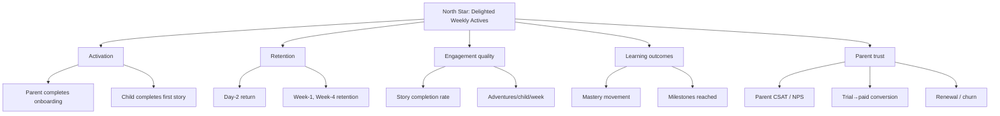

### 22.3 Definitions & targets (directional, to be calibrated on real data)

| Metric | Definition | Why it matters | Early target |
|--------|------------|----------------|--------------|
| **Activation** | Parent onboards **and** child completes first story | Proves first magic landed | ≥70% of signups |
| **Day-2 return** | Child returns day after first story | The memory payoff / relationship start | ≥40% |
| **Story completion rate** | Adventures finished ÷ started | Right length + engaging + safe | ≥80% |
| **Adventures/child/week** | Volume of completed adventures | Habit formation | ≥3 (=DWA) |
| **W1 / W4 retention (child)** | Active in week 1 / week 4 | Durable value | ≥55% / ≥35% |
| **Learning outcome** | Net mastery movement + milestones | The actual promise | positive, per-child |
| **Parent CSAT/NPS** | Survey | Trust | NPS ≥ 40 |
| **Trial → paid** | Conversion | Willingness to pay | ≥8–12% |
| **Monthly churn** | Cancels ÷ subscribers | Moat working | ≤5% |
| **Cost/session** | LLM+image+TTS+infra per session | Unit economics | trend down; below price/usage headroom |
| **Virality (k)** | Invites × conversion | Growth efficiency | build toward ≥0.3 |
| **LTV : CAC** | Lifetime value ÷ acquisition cost | Business viability | ≥3:1 at scale |

### 22.4 Unit economics note
Because every session costs inference, **cost/session is a headline metric from day 1**, traced per generation (Section 19.9). The levers if it runs hot: media caching/reference reuse, model right-sizing via the router, prompt minimization, and prefetch discipline. A subscription price is only set once cost/session and typical sessions/month give comfortable gross margin.

### 22.5 Guardrail metrics (wellbeing)
We *watch and cap*, not maximize: session length distribution (flag over-long sessions), sessions/day (flag compulsive patterns for parent awareness), and safety-incident rate (must trend to ~0; any serious incident is a stop-the-line event). These guardrails can *veto* growth tactics.

---

## 23. Risks

Each risk: description, severity, and mitigation. Severity = potential impact × likelihood.

### 23.1 Technical risks
- **Illustration inconsistency (High).** The companion looking different each scene breaks attachment. *Mitigation:* canonical descriptors + reference assets + fixed style tokens + caching; prototype in week 1; continuous investment; pre-render companion expressions.
- **Latency (High).** A child won't wait. *Mitigation:* prefetch, streaming, narration-as-loading, cached media; latency budgets per call-type; the "never a spinner" rule enforced in QA.
- **Provider dependency/outage (Medium).** *Mitigation:* router + adapters + fallbacks + safe fallback beats so an outage degrades gracefully.
- **Memory scale/retrieval quality (Medium).** *Mitigation:* salience-bounded LTM, hybrid retrieval, token budgets; split to dedicated vector store only when needed.
- **Cost/session too high (High).** *Mitigation:* the Section 19.9 levers + a global inference-budget breaker; price set from real economics.

### 23.2 Product risks
- **Feels like school (High, thesis-breaking).** *Mitigation:* Principle #1 as a review gate; no lessons/quizzes/grades ever in the child UI; learning only in the backend; eval that the objective is *invisible*.
- **Novelty churn (Medium).** Kids love it for a week then leave. *Mitigation:* the memory/companion relationship + evolving difficulty + interest tracking is the anti-novelty engine; measure W4 retention hard.
- **Parent doesn't perceive value (Medium).** *Mitigation:* honest, specific reports + transparency log + visible growth; renewal is a designed moment.

### 23.3 AI risks
- **Unsafe/inappropriate content reaching a child (Critical, existential).** *Mitigation:* defense-in-depth (Section 13), independent output classifier, image scan, safe fallbacks, red-team evals gating every release, human review sampling, stop-the-line culture.
- **Prompt injection via child input/profile/memory (High).** *Mitigation:* untrusted-data labeling, tap-first (minimal free text), structured-output validation, injection scrubbing.
- **Hallucination presented as truth (Medium-High for this audience).** *Mitigation:* fictional framing, vetted knowledge scope, defer-to-grown-up, no real-world safety advice.
- **Over-attachment / wellbeing harm (High, reputational + ethical).** *Mitigation:* the 2.5/9.5/13.6 guardrails — caps, outward-pointing companion, no dark patterns, DWA (not time) as North Star.

### 23.4 Business risks
- **Regulatory (COPPA/GDPR-K) misstep (High).** *Mitigation:* COPPA-first architecture from day 1, verifiable consent, data minimization, legal counsel before public beta.
- **Unit economics don't close (High).** *Mitigation:* cost instrumentation from day 1; pricing from real data; efficiency levers.
- **Trust incident / bad press (Critical).** A single viral "look what it said to my kid" post is fatal. *Mitigation:* transparency as a feature, conservative safety posture, rapid response + rollback, humility in messaging.

### 23.5 Competition & scaling
- **Big-tech entrant (Medium-High).** OpenAI/Google/Duolingo could build near-adjacent products. *Mitigation:* the moat is per-child memory + parent trust + child-safety practice, which compound and are hard to fast-follow; move fast, earn trust, accumulate memory.
- **Scaling ops as a solo founder (Medium-High).** *Mitigation:* modular monolith, managed infra (don't self-host Postgres/Redis), boring tech, Claude as force-multiplier, and split services only under real load. Guard your own time and energy as the scarcest resource — an over-ambitious ops footprint is how solo founders stall.

### 23.6 Risk matrix

| Risk | Severity | Likelihood | Priority |
|------|----------|-----------|----------|
| Unsafe content to a child | Critical | Low (if we execute) | P0 |
| Trust incident / press | Critical | Medium | P0 |
| Feels like school | High | Medium | P0 |
| Illustration inconsistency | High | Medium | P1 |
| Cost/session too high | High | Medium | P1 |
| Regulatory misstep | High | Low-Med | P1 |
| Latency | High | Medium | P1 |
| Over-attachment harm | High | Low-Med | P1 |
| Novelty churn | Medium | Medium | P2 |
| Provider outage | Medium | Medium | P2 |
| Big-tech entrant | High | Medium | P2 (strategic) |

---

## 24. Competitive Analysis

The honest framing: **many great kids'-learning and AI products exist; none is a persistent, personalized narrative companion that remembers a child for years.** That gap is the wedge.

### 24.1 Landscape

| Product | What it is | Strengths | Weaknesses vs. us | Where we differ fundamentally |
|---------|-----------|-----------|-------------------|-------------------------------|
| **Duolingo** | Gamified language drills | World-class habit loops, brand, engagement science | Drill/quiz loop, not narrative; same content for all; older skew; extrinsic-reward heavy | We're story-native, personalized, memory-driven, not a streak machine |
| **Khan Academy Kids** | Free early-learning activities + characters | Free, curriculum-solid, beloved characters, trusted | Static content library; same for every child; no persistent memory of the child | We generate a unique world per child that remembers them |
| **Lingokids** | Playlearning app, games + songs | Broad early-learning content, playful | Curated static content; limited personalization; no companion memory | Personalized generative narrative vs. content library |
| **ABCmouse** | Comprehensive early-learning curriculum | Breadth, structured curriculum, scale | Feels like school/curriculum; static; dated UX; low delight | We hide learning inside story; delight-first |
| **Pok Pok** | Open-ended Montessori digital toys | Gorgeous design, open play, no dark patterns | No narrative/companion, no learning tracking, no personalization-by-memory | We add companion, memory, adaptive learning arc |
| **Osmo** | Physical-digital hybrid play | Tactile, hardware moat, parent trust | Hardware cost/friction; session-bound; not a persistent companion | Software-first persistent relationship (hardware is a *future*, Section 25) |
| **ChatGPT / Claude / Gemini** | General assistants | Powerful general models | Not built for 3–7; chat-UI; not safe-by-construction for kids; no memory-as-companion, no illustration/voice storybook, no parent trust layer | We are a purpose-built, safe, story-native product on top of such models — not a chatbot |
| **Character.AI** | Persona chat / companionship | Compelling persistent characters, attachment | **Chat UI; not for young kids; well-documented safety concerns for minors; engagement-maximizing** | We are the *safe, parent-trusted, learning-oriented, non-chat* answer to "AI companion for a child" |

### 24.2 The fundamental difference (why we're not any of them)
Every incumbent is one of: a **static content library** (Khan Kids, Lingokids, ABCmouse, Pok Pok), a **drill/gamification loop** (Duolingo, ABCmouse), a **hardware play** (Osmo), or a **general/companion chatbot not built for young children** (ChatGPT/Claude/Gemini/Character.AI). **None is a persistent, personalized, illustrated, voiced narrative companion that remembers a specific child and teaches invisibly through story, with parent trust and child-safety built in as architecture.** 

Our two compounding moats — **(1) the per-child memory graph** (a year of shared history is not fast-followable) and **(2) parent trust earned through radical transparency and safety** — are exactly the things a fast-following incumbent cannot copy overnight, because both take *time per child* to accumulate. That is the defensibility thesis.

### 24.3 Competitive risks & honest counterpoints
The incumbents have distribution, brand, and capital we lack; a big-tech entrant is plausible (Section 23.5). Our answer is not to out-spend but to **out-care and out-accumulate**: be the safest, most transparent, most genuinely personalized product, and let the memory moat compound while trust makes parents advocates. Speed to trusted-and-remembered is the game.

---

## 25. Future Vision

The MVP is a personalized storybook. The company is *the operating system for childhood learning*. Here is the ten-year arc and how it becomes a billion-dollar company — grounded in the same moats (memory + trust) rather than hand-waving.

### 25.1 Modality expansion
- **Voice-first conversation (near-term):** the child *talks* with the companion; the storybook becomes a spoken adventure. This deepens attachment and removes the last literacy barrier. (Requires robust child-ASR + even stronger safety.)
- **Ambient / companion device (mid-term):** a gentle, screen-optional home device or plush — the companion present in the room, screen-light, bedtime-friendly. Extends session contexts and trust; a natural hardware attach.
- **AR (mid-term):** the companion and story world appear in the child's real space; treasure hidden around the living room; embodied, active play that answers screen-time concerns.
- **VR (long-term, cautious):** fully immersive worlds for older children, with heavy wellbeing guardrails.
- **Robotics (long-term):** a physical companion — the fullest realization of *The Diamond Age*'s vision — as a premium tier.

### 25.2 Format expansion
- **Physical books / printed keepsakes:** print a child's actual personalized adventures as a real book — a beloved, giftable, high-margin artifact that also markets the product to every relative who sees it.
- **Personalized audio (podcast-style adventures)** for car/bedtime, screen-free.

### 25.3 Market expansion (beyond D2C families)
- **Schools & teachers:** educator console, rostering, standards alignment, per-child insight at classroom scale (Section 3.3). A large, durable market; also a trust/credibility multiplier.
- **Homeschool:** a natural, underserved, high-intent segment.
- **Therapists & special education:** fine-grained tailoring (Section 3.4) for speech, anxiety, autism-spectrum, dyslexia-risk. Building for the margins strengthens the core and is a powerful trust and impact story.
- **Global / i18n:** the engine is language-agnostic by design; expansion is content + safety localization, not a rewrite. Enormous TAM in non-English early education.

### 25.4 Platform & ecosystem
- **Educational marketplace:** curated story worlds, characters, and skill packs — some first-party, some from vetted creators (authors, educators, illustrators, brands) — all passing our safety pipeline. Revenue share; supply-side moat.
- **Developer platform:** APIs/SDKs for third parties to build safe, personalized, memory-aware kids' experiences on our safety + memory + illustration infrastructure. The infrastructure play: we become the trusted rails for "AI + kids."

### 25.5 The deepening moat
Every year, each child's memory graph deepens and the learning/interest models sharpen — switching cost (emotional + informational) grows. Our accumulated **child-safety and child-learning research practice** becomes an industry-leading trust asset (publishable, third-party-audited). Parents become advocates. The company that has safely known a generation of children the longest wins.

### 25.6 Why this is a billion-dollar company (the honest case)
1. **Huge, durable market:** parents reliably pay for children's development; add schools, therapy, and global, and the TAM is very large.
2. **Recurring revenue with low churn** *if* the moat works — a companion that has known a child for years is not casually cancelled.
3. **Compounding, defensible moats** (memory + trust) that incumbents can't fast-follow because they accrue per-child over time.
4. **Multiple expansion vectors** (modality, format, market, platform) off one core engine — each reusing the same memory + safety + illustration infrastructure.
5. **A mission that attracts talent, capital, and trust** — "give every child a companion that helps them learn and grow" is the kind of durable, important mission that sustains a decade-long company.

> **Closing principle.** The entire opportunity rests on doing something most products won't: treating a child's attention and trust as sacred rather than as a resource to extract. Paradoxically, that restraint is also the strongest business strategy here — because in *this* category, trust is the moat, and trust is only earned by deserving it. Build the thing that genuinely helps children, keep it safe by construction, let the memories compound, and the company follows.

---

*End of document — v1.0. This blueprint is intended to be sufficient for a solo founder (building with Claude) to begin implementation immediately. Open decisions were resolved explicitly (Locked Decisions); assumptions were labeled and justified. Update this document as reality contradicts it — it is a living source of truth, much like the product it describes.*


