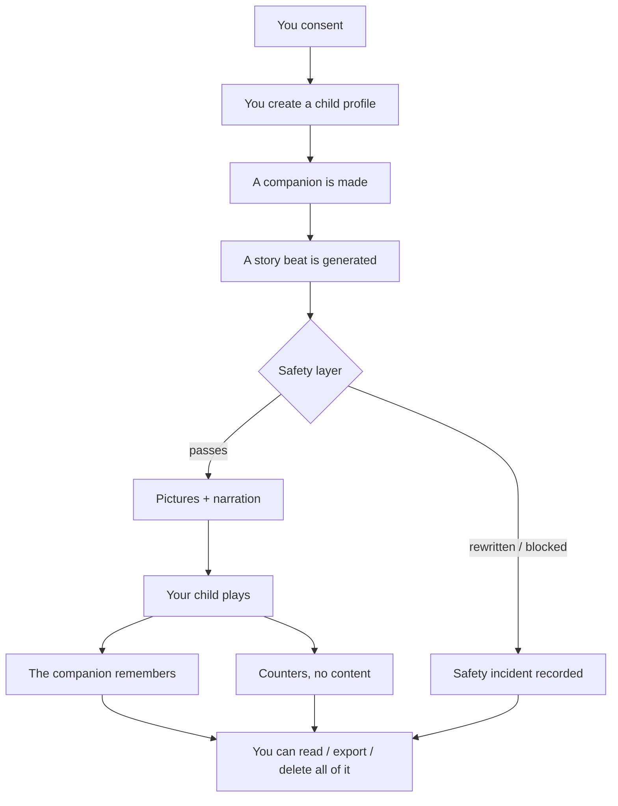

# What happens to your child's data — a parent's guide

**Who this is for:** a parent deciding whether to trust The Primer with their child, and a
parent who already has and wants to check we are still doing what we said.

**What this is:** a walk through every stage your child's data passes, in order, in plain
language — followed by the exact steps for reading, exporting, restricting or deleting all of
it. Nothing here is aspirational. Every claim describes code that exists today, and the
places where we have *not* done something yet are called out as plainly as the places we
have.

**What this is not:** a legal document. It has been written by the people who built the
software and has not been through formal legal review. When it has, this line will say so.
The in-product version of these claims lives in `backend/apps/accounts/privacy.py`, which is
deliberately kept in the backend so that a claim and the code making it true have to change
together.

---

## The short version

- Nothing about your child is generated or sent anywhere until you have consented.
- We collect a first name, a birthdate, and what your child loves and fears. No surname, no
  address, no school, no photograph, no contact details — and the companion is instructed
  never to ask for any.
- Your child's data is never sold, and never used to train anyone's AI models. The server
  refuses to start if it is pointed at a provider whose terms permit training.
- You can read every word your child has been told, export all of it, or delete all of it —
  at any time, without our permission, and without needing to keep consent switched on.
- There are no notifications, no streaks, and no reminders. Every control we give you can
  only make your child's time here *shorter*.

---

## The journey, stage by stage



### Stage 1 — Consent, before anything else

Every operation that *creates* data about your child passes through a single consent gate.
No consent, no processing: no child profile, no companion, no greeting, no story.

The gate deliberately does **not** guard the other direction. If you withdraw consent, we
stop generating anything new — but you keep full access to read, export and delete what
already exists. An earlier version of the product got this wrong and locked parents out of
their own child's records when consent lapsed. That was fixed because withdrawing consent
has to stop *us* using the data, not stop *you* seeing it.

### Stage 2 — What you tell us

For you: an email address. For each child: the first name or nickname you choose, their
birthdate, the things they love, the things they are frightened of, and any topics you ask
us never to include.

Each of those has one job. The birthdate sets the age band the safety layer enforces. The
fears and avoid-topics are copied into *every* generation as hard rules. What they love is
what tomorrow's adventure gets built from.

We do not ask for a surname, an address, a school, a photograph, or any contact detail.

### Stage 3 — The companion

You pick an archetype, a colour palette and a temperament, and your child names it. From
that we write one canonical description of what the companion looks like, save it, and reuse
it for every picture forever — which is why the companion is recognisably the same friend on
day sixty as on day one.

### Stage 4 — Generating a story

To write a story we send the words needed for that beat to an AI provider; to draw it, an
image provider; to read it aloud, a voice provider.

**What goes:** the story context, and your child's first name, because the companion says it
out loud. Also the things you asked us to avoid, the things they fear, and what the companion
remembers — because those are the rules the story must be written against, and a provider
that was not told them could not keep them.

**What does not go:** your email, your account, or anything identifying beyond that first
name.

**On training:** every provider we use is on terms that forbid training on what we send. This
is enforced by the software, not by good intentions — a preflight check
(`privacy.provider_terms`) fails the deployment if any child-data route is pointed at a
cheaper tier that reserves the right to learn from your child's words.

**What we cannot promise:** anything about a provider's own internal operational logs. That
is not ours to control, and we would rather say so than imply a guarantee we do not have.

### Stage 5 — The safety layer

Every generation traverses one path, and there is exactly one door:

```
inputs → guard input → generate → grade output → scan the picture → your child
              ↓                        ↓
        incident recorded    rewrite / replace / escalate
```

Two commitments hold this up, and both are easy to erode, so they are worth stating:

**A guard that could not run is never a pass.** If the classifier is unreachable, the
deterministic check stands alone, the event is recorded as *degraded*, and the log says so.
Nothing in this system converts "we did not check" into "it is fine."

**No decision is silent.** Every non-pass writes a safety incident. You can see these — they
are in your transparency log and in your export, including the ones where we refused or
rewrote something. An export that hid our own refusals would be the one omission you would
most want.

Illustrations are scanned separately before they are ever stored or shown.

### Stage 6 — What the companion remembers

Memories are what let the companion say *"do you still have that dragon you named?"* They are
kept for as long as you keep the account, because losing them would mean losing the
friendship your child has built.

The memory content is **encrypted in the database**, with a key the database itself does not
hold.

### Stage 7 — Reading aloud (optional, and the one to read closely)

If your child is old enough to read, the companion sometimes asks them to read a short line
aloud. If you allow it, we keep that recording.

We are being direct because this is the part you would most want told plainly:

- The recording **stays on our own machine**. It is never uploaded to storage and never sent
  to any other company.
- **Nothing has listened to it** — not a person, not a program.
- It never decides anything about your child, and the app never tells them they read
  something wrong.
- Turning it off for a child **deletes every recording we already hold of them, immediately**.
  Deleting the child or the account does the same.

Its only purpose is letting us check whether the app actually heard a real child correctly.
It was built and tested on adults imitating children, and that is not good enough to correct
a real child with.

### Stage 8 — Counters, not content

We record operational counters — a story started, a beat finished, how long a sitting lasted.

The rule enforced in code is that these carry **shape, never content**. The event writer
accepts simple values only, truncates them, and refuses containers, specifically so that
nobody can casually pass in the narration text and quietly turn a counters table into an
archive of what a four-year-old was told.

These counters are tied to your child's record and are deleted with them. Analytics gets no
exception to the deletion promise.

---

## Your controls — step by step

Everything below is at **`/parent`**, behind the adult gate. None of it requires our
permission, and none of it is affected by withdrawing consent.

### To read what your child has been told

1. Sign in and pass the adult gate.
2. Open **Transparency**.
3. You will see every story, word for word — including the beats our safety layer rewrote or
   replaced.

The other tabs — **Reports**, **Weekly & growth**, **Insights** — are summaries for you.
Transparency is the raw record.

### To export everything

1. Go to **Privacy** (in the dashboard header, not under a child — export and deletion span
   every child).
2. Choose export.
3. You get one zip of JSON: the account, each child's profile and settings, their companion,
   every adventure with every beat and every choice **verbatim**, every memory, learning
   progress, the world map, every report, and our safety incidents.

It contains no embeddings or internal vectors — those are noise that tells you nothing about
your child.

### To restrict without deleting

1. Open a child's **Settings**.
2. Lower the session length, tighten the intensity ceiling, narrow the daily window, or add
   another avoid-topic.

Every control here is a restriction. There is nothing in Settings that makes your child's
time here longer or pulls them back.

### To delete

1. Go to **Privacy**.
2. Delete a child, or delete the whole account.

Deleting a child removes their profile, companion, every story, every memory, every report,
every picture and recording made for them, and any recording of their own voice. Deleting the
account does that for every child and then removes the account.

**Both happen immediately. Neither is reversible.**

One thing is deliberately kept: a dated line recording that a deletion happened, so we can
prove it did. It holds a scrambled form of your email that cannot be turned back into it, and
nothing else about you.

---

## What we never do

- **Never sell** your data or your child's. Not to anyone, not ever.
- **Never train** AI models on your child's data — not ours, not our providers'.
- **Never nudge.** No notification, no reminder, no streak, no mechanic designed to pull your
  child back. This is deliberate, and it is not something we will change quietly.
- **Never let one family's data reach another.** Every request is checked against the account
  that owns it before a single row loads, and that check is tested from the outside with two
  real accounts on every endpoint.

---

## Where we are not finished yet

We would rather you read this section than discover it.

| Area | Where it actually stands |
|---|---|
| Legal review | Not done. This document and the in-product disclosure are written by the engineers who built the system. |
| Backups | A full copy is taken daily and deletes itself after a set retention window (`BACKUP_RETENTION_DAYS`, **7 days** by default), so a deletion you make today is gone from every copy within that window. The in-product disclosure reads this number from the live setting rather than quoting it, so it cannot drift. Today those copies sit on the same machine as the database and are **not separately encrypted**. Before we take on families beyond the pilot they will be encrypted and stored elsewhere. |
| Restores | A backup is only ever used to bring the whole service back after a disaster, never to restore one family. Anything deleted before a disaster is deleted again immediately after the restore — that step is written into the runbook, not left to memory. |
| Access logging | We are a very small team and nobody outside it can reach this data. Audited access logging on child data is not built yet. Before we take on families beyond the pilot we will add it and say so here. |
| Provider logs | We control what we send and the terms it is sent under. We do not control a provider's internal logs, and we do not claim to. |
| Public policy page | The privacy centre currently sits behind sign-in. A public, no-login policy page does not exist yet. This document is the shareable version until it does. |

---

## Standing

The Primer is built for children, so we design to **COPPA** and **GDPR-K** from the first
line of code rather than retrofitting them.

The whole product thesis is that a parent can *check* what we tell them. That is why the
transparency log is verbatim, why the export includes our own refusals, and why this document
names the things we have not built. If any statement here stops being true of the software,
the statement is the bug.
