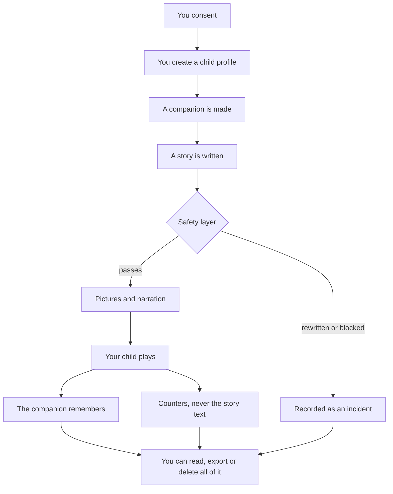

# What I do with your child's data

I built The Primer. I'm writing this myself because I don't think a parent should have to
take a children's product on faith, and because most privacy pages are written to survive a
lawyer rather than to be understood by the person they're addressed to.

So this is the whole thing: what I collect, what leaves my servers, what I keep, and what
I haven't built yet. If you only read one section, read the one about the voice recordings.

---

## The five promises

1. I don't sell your data or your child's. Not to anyone, not at any price.
2. I don't train AI models on your child — not mine, and not my providers'.
3. I don't send your child notifications, reminders, or streaks. Nothing in this product is
   designed to pull them back to it.
4. You can read every word your child has been told, take a copy of all of it, or destroy all
   of it, whenever you want, without asking me.
5. Where I haven't finished something, I say so on this page instead of waiting for you to
   find out.

---

## The whole path, on one page

This is every stage your child's data passes through, in order. The rest of this document is
just these boxes explained one at a time.



---

## Nothing happens before you say yes

Every operation that creates data about your child runs through one consent check. Without
your consent there is no profile, no companion, no greeting, no story. Nothing is generated
and nothing is sent anywhere.

Withdrawing it later stops me making anything new. It does not lock you out of what already
exists.

I'm making a point of that because I got it wrong once. For a while, one function guarded
both "may I generate?" and "may you look?", so a parent who withdrew consent also lost access
to their own child's records — couldn't read them, couldn't export them. That's backwards. If
you revoke consent, the thing that should stop is *me using the data*, not *you seeing it*.
It's split into two separate checks now.

---

## What I ask for, and what each thing is for

From you: an email address. That's it.

For each child:

| What | Why it exists |
|---|---|
| First name or nickname | The companion says it out loud |
| Birthdate | Sets the age band the safety layer enforces |
| What they love | What tomorrow's story gets built out of |
| What frightens them | Copied into every generation as a hard rule |
| Topics to avoid | Same — a rule on every single generation |

Then, as they play: the stories, the choices they make, how long a sitting lasted, and what
the companion remembers.

I don't ask for a surname, an address, a school, a photograph, or any contact detail for your
child. The companion is instructed never to ask for one either.

---

## What actually leaves my servers

Writing a story needs an AI model, drawing it needs an image model, reading it aloud needs a
voice. Three companies are involved, and they don't all get the same thing. As configured
today:

| Who | What they receive |
|---|---|
| **Google** (Gemini on Vertex AI) | The most. Writes the story, grades it for safety, condenses the memories, and checks the pictures. This is the one that sees your child's first name, their fears, your avoid-topics, and what the companion remembers. |
| **Cloudflare** (Workers AI) | Draws the pictures. Gets a description of the companion and the scene it's standing in. Google's Imagen is the backup if Cloudflare is unavailable. |
| **Google Cloud Text-to-Speech** | Turns the finished sentence into audio. That sentence contains your child's first name whenever the companion says it. ElevenLabs is the backup. |

Google sees the most because it's doing the thinking. It gets your child's fears, your
avoid-topics and the companion's memories for one reason: those are the rules the story must
be written against, and a model that wasn't told them couldn't keep them.

**None of them get:** your email, your account, or anything identifying your child beyond
that first name.

On training: every route is on terms that forbid training on what I send. That isn't a
promise I'm asking you to trust — the server refuses to boot if it's pointed at a cheaper
tier that reserves the right to learn from your child's words. I can't misconfigure it in a
hurry and not notice.

What I can't promise is anything about a provider's own internal logging. That isn't mine to
control. I'd rather write that sentence than imply a guarantee I don't have.

---

## The safety layer

Every generation takes one path, and there's only one door:

```
what goes in  →  cleaned  →  story written  →  graded  →  picture scanned  →  your child
                                                 ↓
                                   rewritten, replaced, or escalated
                                        (and always recorded)
```

Two rules hold this up.

**If a check couldn't run, that is not a pass.** When the model-based grader is unreachable,
the rule-based check stands on its own, and the beat is recorded as degraded. Nothing in this
system turns "I didn't check" into "it's fine."

**Nothing is decided quietly.** Every rewrite, block and escalation is written down. You can
see them — they're in your transparency log and in your export. I include my own refusals
because if I hid them, that's precisely the thing you'd most want to have seen.

Pictures are scanned on their own before they're stored or shown.

---

## What the companion remembers

The memories are the point of the product. They're what let it say *"do you still have that
dragon you named?"* six weeks later. I keep them as long as you keep the account, because
throwing them away would mean throwing away the friendship your child built.

The memory text is encrypted in the database, with a key the database doesn't hold.

---

## The voice recordings — read this one properly

If your child can read, the companion sometimes asks them to read a line aloud. If you allow
it, I keep that recording. Here is exactly what that means.

- It stays on my own server. It is never uploaded to storage and never sent to another
  company.
- Nothing has listened to it. Not a person, not a program.
- It never decides anything about your child, and the app never tells them they got a word
  wrong.
- Switch it off for a child and every recording I hold of them is deleted immediately.
  Deleting the child or the account does the same.

Why I keep them at all: I need to know whether the app actually heard a real child. It was
built and tested on adults imitating children, and that isn't good enough to correct a real
five-year-old with.

If that trade isn't one you want to make, turn it off. The rest of the product works exactly
the same without it.

---

## What I count

I record that a story started, that a beat finished, how long a sitting ran.

These carry shape, never content. The code that writes them accepts simple values only,
truncates them, and rejects anything larger — specifically so that nobody, including me on a
tired evening, can pass in the story text and quietly turn a counter table into a transcript
of what a four-year-old was told.

They're attached to your child's record and they die with it. Analytics gets no exception to
deletion.

---

## What you can do about any of it

All of this lives at **`/parent`**, behind the adult gate. None of it needs my permission, and
none of it is affected by withdrawing consent.

**Read what your child was told.** Sign in → **Transparency**. Every story, word for word,
including the ones the safety layer rewrote or replaced. Reports, Weekly & growth and Insights
are summaries for you; Transparency is the raw record.

**Take a copy.** **Privacy** in the header → export. One zip: the account, each child's
profile and settings, their companion, every adventure with every beat and every choice
verbatim, every memory, learning progress, the world map, every report, and my safety
incidents. No embeddings — a few hundred numbers per memory would tell you nothing.

**Limit it without deleting.** A child's **Settings**: shorter sittings, a lower intensity
ceiling, a narrower daily window, more avoid-topics. Every control there can only reduce.
There is nothing in this product that lengthens your child's time in it.

**Delete it.** **Privacy** → delete a child, or the whole account. A child takes their
profile, companion, every story, memory, report, picture, and any recording of their voice.
The account does that for every child, then removes the account.

Both are immediate and neither can be undone. I keep one thing: a dated line saying a
deletion happened, so I can prove it did. It holds a scrambled form of your email that can't
be turned back into an address, and nothing else.

---

## What I haven't done yet

| | Where it actually stands |
|---|---|
| Legal review | Hasn't happened. I wrote this and I wrote the code. |
| Backups | Full copy daily, each deleting itself after 7 days, so a deletion today is gone from every copy inside a week. Right now those copies sit on the same machine as the database and aren't separately encrypted. That changes before I take families beyond the pilot. |
| Restoring one | A backup only ever brings the whole service back after a disaster. It is never used to restore one family. Anything deleted before the disaster gets deleted again straight after — that step is in the written procedure, not in my memory. |
| Access logs | Nobody outside a very small team can reach this data, but I don't yet have audited logging of who looked at what. I'll build it before the pilot widens, and this page will say so when I have. |
| Provider logs | I control what I send and the terms it's sent under. I don't control what a provider writes in its own logs, and I'm not going to pretend otherwise. |
| A public version of this | The privacy centre is still behind sign-in, which means you have to create an account to read it. That's the wrong way round and I know it. This document is what I can hand you until there's a page anyone can open. |

The 7-day number is read from the live setting wherever it's shown in the app, so it can't
drift away from what the backups actually do.

---

## Where this stands

The Primer is built for children, so COPPA and GDPR-K shaped it from the first line rather
than being bolted on before launch.

The whole idea of this product is that you can check me. That's why the transparency log is
word for word, why my own refusals are in your export, and why the list above exists. If
anything on this page stops being true of the software, treat that as a bug and tell me.

— Ullas, founder
